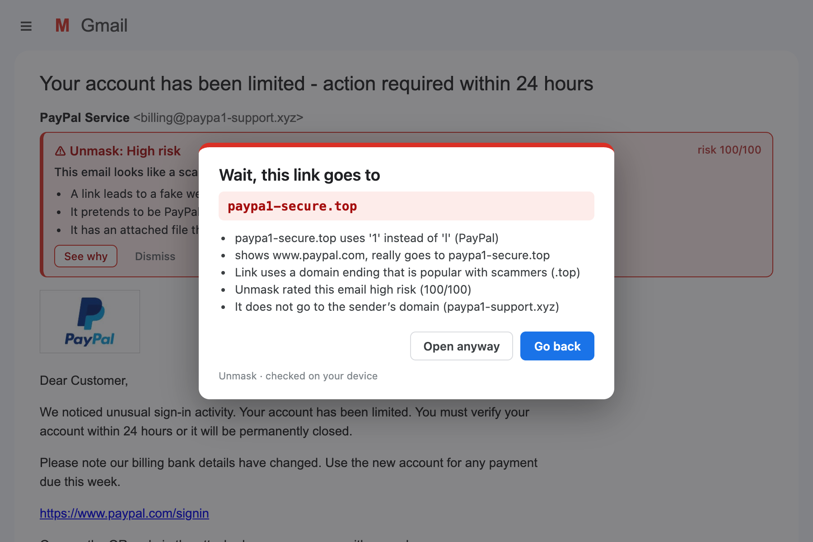
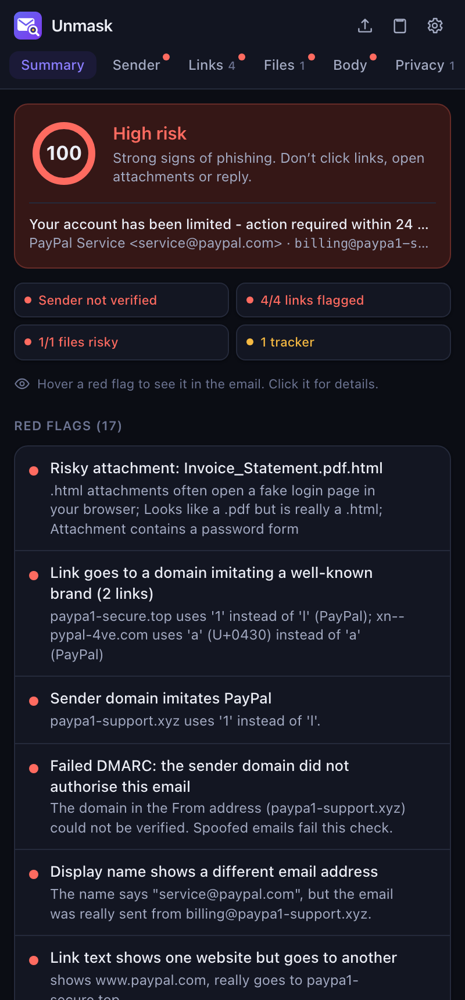
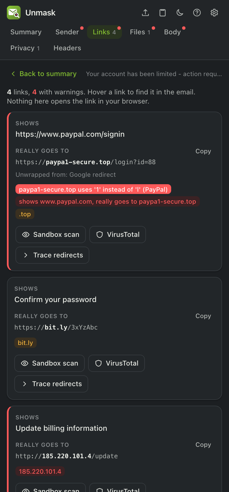
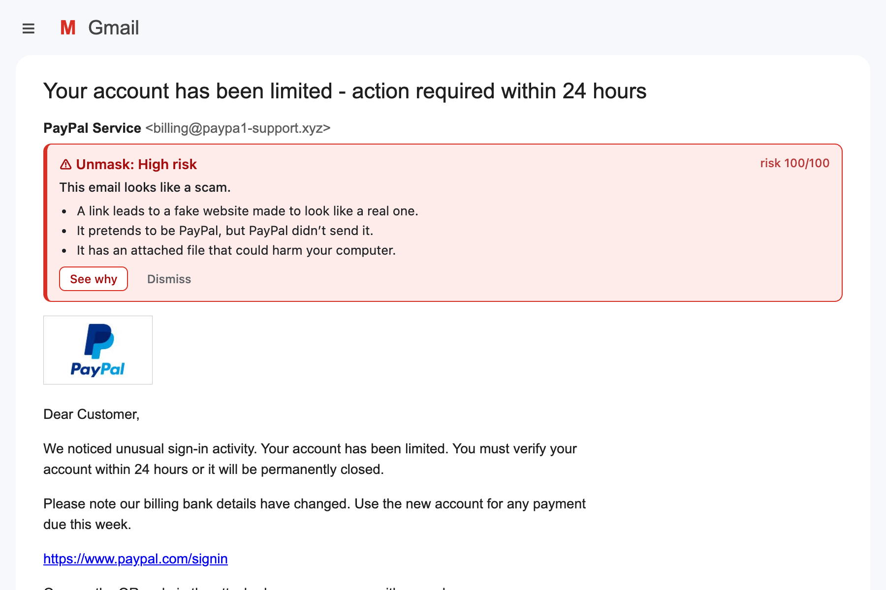
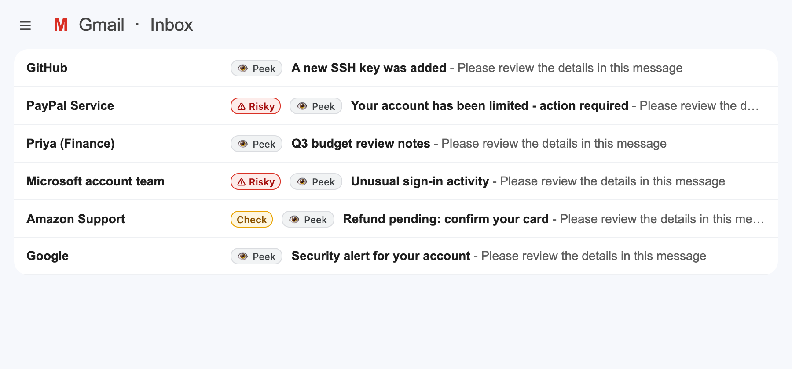
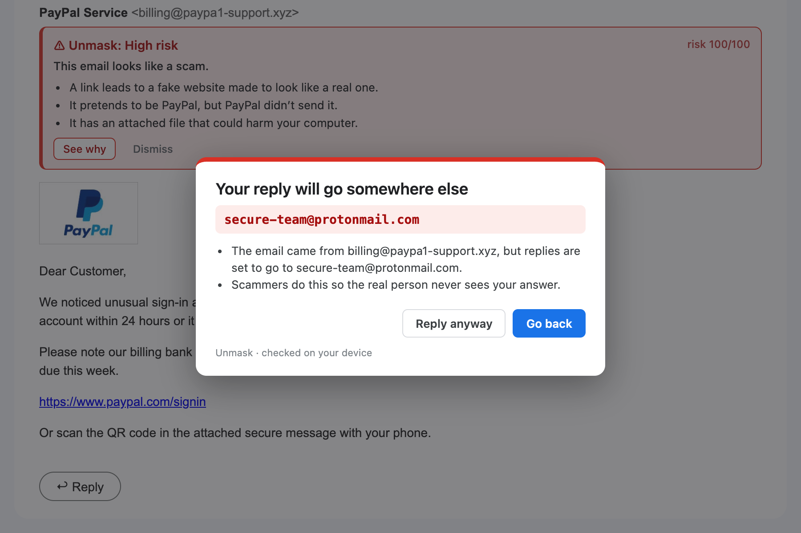
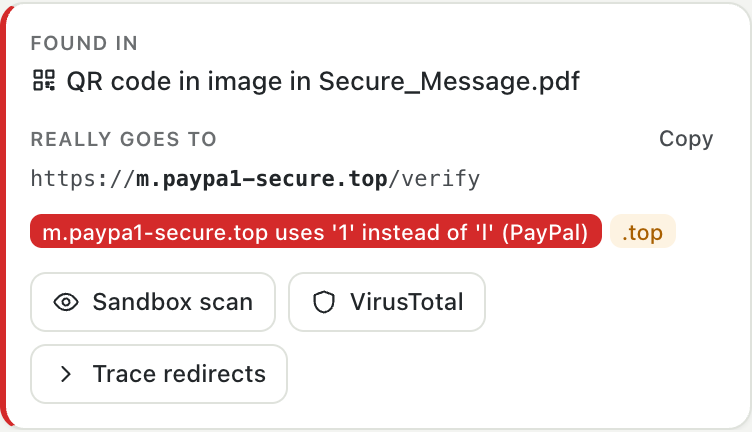
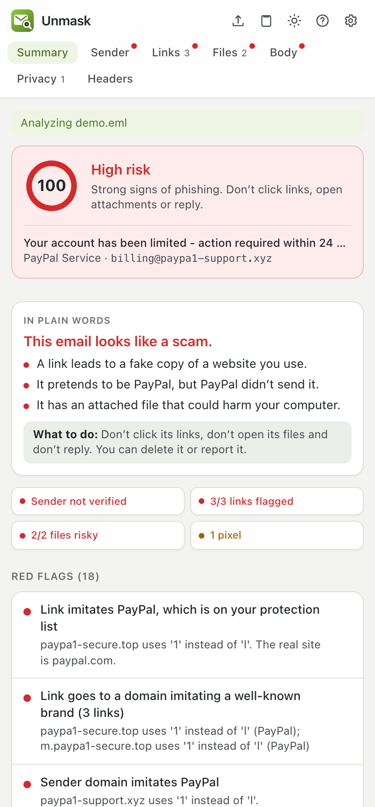
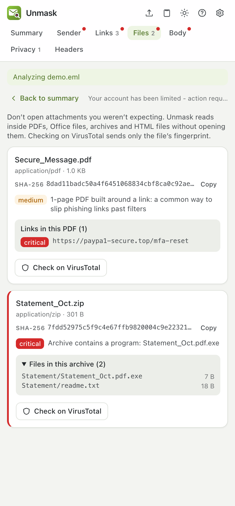
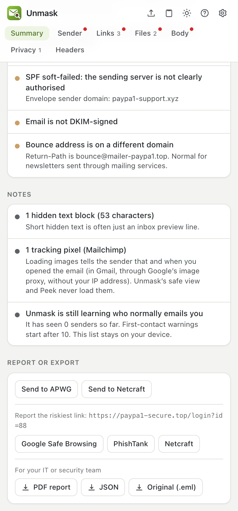

<p align="center">
  
</p>

<h1 align="center">Unmask</h1>

<p align="center">
  <b>See what a suspicious email is really hiding.</b><br>
  A browser extension for Gmail and Outlook that stops you before you click a phishing link, and explains in plain language what the email is really hiding.
</p>

<p align="center">
  
</p>

<p align="center">
  <a href="https://github.com/praneeth132006/Unmask/releases/latest"></a>
  <a href="https://github.com/praneeth132006/Unmask/actions/workflows/ci.yml"></a>
  <a href="https://github.com/praneeth132006/Unmask/actions/workflows/codeql.yml"></a>
  <a href="LICENSE"></a>
  <a href="CONTRIBUTING.md"></a>
</p>

<p align="center">
  <a href="https://praneeth132006.github.io/Unmask/"><b>Website</b></a> ·
  <a href="https://praneeth132006.github.io/Unmask/guide.html"><b>User guide</b></a> ·
  <a href="https://github.com/praneeth132006/Unmask/wiki">Wiki</a> ·
  <a href="docs/CHECKS.md">What it checks</a> ·
  <a href="docs/ARCHITECTURE.md">How it works</a> ·
  <a href="docs/BACKEND.md">Redirect-trace server</a> ·
  <a href="docs/LIMITS_AND_COSTS.md">Limits &amp; costs</a> ·
  <a href="CHANGELOG.md">Changelog</a> ·
  <a href="docs/PUBLISHING.md">Publishing</a> ·
  <a href="CONTRIBUTING.md">Contributing</a> ·
  <a href="SECURITY.md">Security</a> ·
  <a href="PRIVACY.md">Privacy</a>
</p>

---

## Quick start

> **1. Download** [`unmask-chrome-<version>.zip`](https://github.com/praneeth132006/Unmask/releases/latest) from the latest release (under *Assets*) and unzip it.<br>
> **2. Load it:** open `chrome://extensions`, switch on **Developer mode** (top right), click **Load unpacked**, and pick the unzipped folder (the one with `manifest.json` in it).<br>
> **3. Use it:** reload Gmail, open any email, and click the Unmask icon.
>
> 📖 **[Read the user guide](https://praneeth132006.github.io/Unmask/guide.html)**: every screen explained, step-by-step key setup, troubleshooting. Also in the [wiki](https://github.com/praneeth132006/Unmask/wiki) and [docs/USER_GUIDE.md](docs/USER_GUIDE.md).

<p align="center">
  
  &nbsp;
  
  &nbsp;
  
</p>

## See it in action

**It stops the click.** Gmail shows `https://www.paypal.com/signin`, but the link really goes to `paypa1-secure.top`. Unmask catches it before the page opens and says why, in plain words.

**It warns you inside your inbox, without opening anything.** Risky emails get a banner with the main reasons; risky senders get a badge in the email list.

<p align="center">
  
  &nbsp;
  
</p>

**It checks emails before you open them.** Click **👁 Peek** on any inbox row: Unmask checks the email and shows a text-only preview, without opening it, so its trackers never learn you looked. Explanations come in plain words, and a shareable protection list puts your own bank and boss first.

<p align="center">
  
  &nbsp;
  
</p>

**It catches replies going to the scammer** and QR codes hidden in PDFs, and it looks inside attachments without opening them.

<p align="center">
  
  &nbsp;
  
</p>

<p align="center">
  
  &nbsp;
  
  &nbsp;
  
</p>

## What it does

Unmask works in **Gmail** and **Outlook on the web**, in **Chrome, Edge, Brave and Firefox**. As soon as you open an email it warns you inside your inbox: a red or amber banner above risky emails, a badge next to risky senders in the list, *"Wait, this goes to paypa1-secure.top"* before a dangerous link opens, and a warning when Reply would go to a different address.

Click the Unmask icon for the full report. The side panel shows:

- **A risk score from 0 to 100** with a verdict: *High risk*, *Suspicious* or *No red flags found*.
- **Every red flag in plain language**, for example *"The name says service@paypal.com, but the email was really sent from billing@paypa1-support.xyz."*
- **Where each link really goes**, with redirect wrappers removed, and buttons to see the final page in a sandbox.
- **Attachment checks**, including files pretending to be something else (`Invoice.pdf.html`) and a VirusTotal lookup.
- **Hidden text and tracking pixels** the sender didn't want you to see.
- **"You've never received mail from paypa1-support.xyz. Your PayPal emails usually come from paypal.com."** Unmask remembers, only on your device, who normally emails you.
- **Report it in one click** to Gmail, APWG, Netcraft, Google Safe Browsing or PhishTank, or export a PDF or JSON report for your IT team.

**Hover any red flag, link, or URL in the plain text and Unmask outlines that exact part of the email in Gmail.** Click a red flag to jump to the details, then use **Back to summary** to return. Switch between light, dark and system themes from the header.

<p align="center">
  
  &nbsp;
  
</p>

Using another mail app? Save the email as an `.eml` file and drop it on the panel, or paste its raw source.

## Highlights

| | |
|---|---|
| **Sender checks** | SPF, DKIM and DMARC; display names that hide another address; look-alike domains such as `paypa1.com` or `pаypal.com` (Cyrillic а) for 50+ brands; brand names sent from free webmail; Reply-To and bounce addresses elsewhere; brand-new domains. |
| **Where the trackers are** | Each tracking pixel's service, address, and exact spot ("image 2 of 2, at the very end, after '…Unsubscribe'"), tagged in the safe view and in Gmail. Pixels are never loaded. |
| **Peek before opening** | Checks an inbox email without opening it; text-only preview, no trackers. Optional automatic checks of unread mail. |
| **Plain words** | Every verdict in one everyday sentence with what to do; simple mode for non-technical users. |
| **Protection list** | Your bank, your boss and trusted senders: impostors get critical warnings. Export/import to protect a whole family or team. |
| **Sender history** | First-contact warnings, "your PayPal emails usually come from paypal.com", and a contact's name used from another address. Kept only on your device. |
| **Payment fraud (BEC)** | Changed bank details, payment and wire requests, gift-card asks, and "are you available? keep this confidential" openers. |
| **QR codes** | Decodes QR codes in images and PDFs and checks where they really go. |
| **Fake logos** | An email showing PayPal's logo that PayPal didn't send, by asset host, alt text or image fingerprint. |
| **Domain intelligence** | Brand-new TLS certificates (Certificate Transparency) and domains without mail records (DNS), from free public sources. |
| **Link checks** | Text that shows one site but links to another; Google, Microsoft Safe Links and Proofpoint wrappers removed; IP addresses, punycode, `user@host` tricks, shorteners, free hosting, risky endings like `.top`. |
| **Attachment checks** | Executables, disk images, HTML/SVG attachments, macro documents, double extensions, right-to-left filename tricks, password-protected ZIPs. Looks inside: links hidden in PDFs, macros and remote templates in Office files, the file list of ZIPs, and a safe preview of HTML attachments. |
| **Body checks** | Invisible text used to fool spam filters, forms and password fields inside the email, pressure and urgency phrases. A safe view with scripts off, links disabled and remote images blocked. |
| **Privacy** | Tracking pixels and click-tracked links from ~40 services (Mailchimp, HubSpot, Mailtrack, Superhuman, …). |
| **Optional online checks** | VirusTotal for files and links, urlscan.io for a sandbox screenshot of where a link lands, and a self-hosted server that traces redirect chains. Each one is set up from inside the panel. |

See [docs/CHECKS.md](docs/CHECKS.md) for every check and how many points it adds.

## Install

Unmask isn't on the Chrome Web Store yet, so you load it yourself. It takes about two minutes and works in Google Chrome, Edge and Brave.

### Option 1: No-code install (recommended)

1. Open the **[latest release](https://github.com/praneeth132006/Unmask/releases/latest)** and, under **Assets**, download **`unmask-chrome-<version>.zip`** (for example `unmask-chrome-0.2.1.zip`). Not "Source code".
2. **Unzip it.** You get a folder named `unmask-chrome-<version>` containing `manifest.json`. Move it somewhere permanent, such as **Documents**: Chrome loads Unmask from this folder.
3. Open **`chrome://extensions`** in the address bar and turn on **Developer mode** (switch in the top-right corner).
4. Click **Load unpacked** and select the unzipped folder, the one that directly contains `manifest.json`.
5. Click the puzzle-piece icon in Chrome's toolbar and **pin Unmask**.
6. **Reload Gmail**, open an email, and click the Unmask icon.

Stuck? The [user guide](docs/USER_GUIDE.md#1-install) covers common errors (such as *Manifest file is missing*) and how to update without losing your settings.

### Option 2: Build from source

**You need:** [Node.js](https://nodejs.org) 20 or newer and [pnpm](https://pnpm.io/installation).

```bash
git clone https://github.com/praneeth132006/Unmask.git
cd Unmask
pnpm install
pnpm build
```

Then follow steps 3–6 above, selecting the **`build/unmask-chrome`** folder inside the project.

The [user guide](docs/USER_GUIDE.md) walks through each step, explains every part of the report, and covers troubleshooting.

## Optional: extra checks

Unmask works with no setup at all. These free services add extra checks you run with a button:

| Service | What it adds | Free limit | Setup |
|---|---|---|---|
| **VirusTotal** | Checks attachments (by fingerprint) and links against 70+ antivirus engines | 4 lookups/min, 500/day | Click **Check on VirusTotal** on any file or link and follow the 3 steps in the panel |
| **urlscan.io** | Opens a link in urlscan's sandbox browser and shows a screenshot of where it lands | 1,000 unlisted + 50 private scans/day | Click **Sandbox scan** on any link and follow the steps |
| **Redirect tracing** | Follows a link's redirects without opening it | Free, unlimited | Built in: click **Trace redirects** and allow once. A self-hosted server is optional ([docs/BACKEND.md](docs/BACKEND.md)) |

**Free keys can never be charged.** Going over a limit just pauses that check until the quota resets. Paid plans exist only for heavy or commercial use: see **[Free limits and costs](docs/LIMITS_AND_COSTS.md)** for every number and price.

<p align="center">
  
  &nbsp;
  
</p>

## Privacy

- The email is analyzed **inside your browser**. It is never sent to an Unmask server.
- Online checks run only when you click them, and send the minimum: a link, or a file's fingerprint (not the file).
- Uploading a file to VirusTotal needs an extra confirmation, because uploaded files can be downloaded by VirusTotal's customers.
- API keys are stored only in your browser.

Full details: [PRIVACY.md](PRIVACY.md).

## For developers

```bash
pnpm dev         # extension with hot reload (opens a Chrome window)
pnpm test        # extension and backend test suites
pnpm typecheck
pnpm backend     # redirect-trace server on http://localhost:8787
pnpm build       # production build into build/unmask-chrome
```

- [docs/ARCHITECTURE.md](docs/ARCHITECTURE.md): how the parts fit together, how the Gmail message is read, the highlight bridge, and the security model.
- [CONTRIBUTING.md](CONTRIBUTING.md): project layout, adding a check or a brand, testing, and commit style.
- [CHANGELOG.md](CHANGELOG.md): what changed in each version.

## Limitations

- Automatic detection works in **Gmail on the web**. Other mail apps work through `.eml` files or pasted source.
- Gmail changes its page structure from time to time. If Unmask stops finding the open email, use the `.eml` fallback and [open an issue](https://github.com/praneeth132006/Unmask/issues).
- Heuristics give false positives and miss some attacks. **Treat the score as advice, never as a guarantee.**

## Community

- Questions and bugs: [open an issue](https://github.com/praneeth132006/Unmask/issues/new/choose). There's a template for wrong verdicts.
- Contributing: see [CONTRIBUTING.md](CONTRIBUTING.md) and the [code of conduct](CODE_OF_CONDUCT.md).
- Security problems: report privately, see [SECURITY.md](SECURITY.md).

## License

Unmask is free software under the [MIT licence](LICENSE). The release zip includes `LICENSE.txt` and `THIRD_PARTY_LICENSES.txt` for the open-source libraries it bundles (React, postal-mime, tldts, punycode).
