<p align="center">
  
</p>

<h1 align="center">Unmask</h1>

<p align="center">
  <b>See what a suspicious email is really hiding.</b><br>
  A browser extension for Gmail and Outlook that stops you before you click a phishing link, and explains in plain language what the email is really hiding.
</p>

<p align="center">
  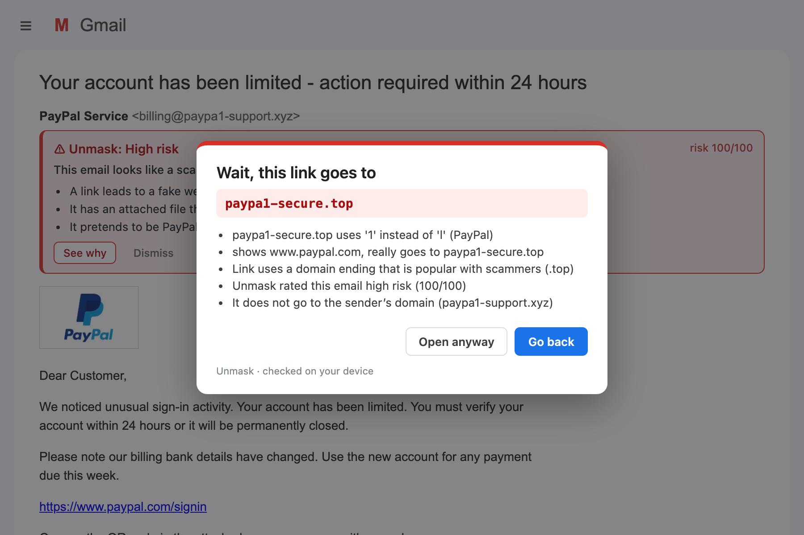
</p>

<p align="center">
  <a href="https://chromewebstore.google.com/detail/unmask-%E2%80%94-phishing-email-i/bcogajaabcenbcbfbcgfjmccjdlfklcc"></a>
  <a href="https://addons.mozilla.org/en-US/firefox/addon/unmask-phishing-inspector/"></a>
  <a href="https://github.com/praneeth132006/Unmask/releases/latest"></a>
  <a href="https://github.com/praneeth132006/Unmask/actions/workflows/ci.yml"></a>
  <a href="https://github.com/praneeth132006/Unmask/actions/workflows/codeql.yml"></a>
  <a href="LICENSE"></a>
  <a href="CONTRIBUTING.md"></a>
</p>

<p align="center">
  <a href="https://praneeth132006.github.io/Unmask/"><b>Website</b></a> ·
  <a href="https://praneeth132006.github.io/Unmask/guide.html"><b>User guide</b></a> ·
  <a href="https://github.com/praneeth132006/Unmask/wiki">Wiki</a> ·
  <a href="docs/ANALYSIS.md">How it analyses an email</a> ·
  <a href="docs/CHECKS.md">What it checks</a> ·
  <a href="docs/FILE_FORENSICS.md">File forensics</a> ·
  <a href="docs/REPORTS.md">Reports</a> ·
  <a href="docs/REPORTS.md#real-examples">Real examples</a> ·
  <a href="docs/ARCHITECTURE.md">How it works</a> ·
  <a href="docs/BACKEND.md">Redirect-trace server</a> ·
  <a href="docs/TEAMS.md">For teams</a> ·
  <a href="docs/LIMITS_AND_COSTS.md">Limits &amp; costs</a> ·
  <a href="CHANGELOG.md">Changelog</a> ·
  <a href="CONTRIBUTING.md">Contributing</a> ·
  <a href="SECURITY.md">Security</a> ·
  <a href="PRIVACY.md">Privacy</a>
</p>

---

## Quick start

> **Easiest: [Install from the Chrome Web Store](https://chromewebstore.google.com/detail/unmask-%E2%80%94-phishing-email-i/bcogajaabcenbcbfbcgfjmccjdlfklcc)** (Chrome, Edge and Brave) or the **[Firefox Add-ons page](https://addons.mozilla.org/en-US/firefox/addon/unmask-phishing-inspector/)**. Or load it manually:<br>
> **1. Download** [`unmask-chrome-<version>.zip`](https://github.com/praneeth132006/Unmask/releases/latest) from the latest release (under *Assets*) and unzip it.<br>
> **2. Load it:** open `chrome://extensions`, switch on **Developer mode** (top right), click **Load unpacked**, and pick the unzipped folder (the one with `manifest.json` in it).<br>
> **3. Use it:** reload Gmail, open any email, and click the Unmask icon.
>
> 📖 **[Read the user guide](https://praneeth132006.github.io/Unmask/guide.html)**: every screen explained, step-by-step key setup, troubleshooting. Also in the [wiki](https://github.com/praneeth132006/Unmask/wiki) and [docs/USER_GUIDE.md](docs/USER_GUIDE.md).

<p align="center">
  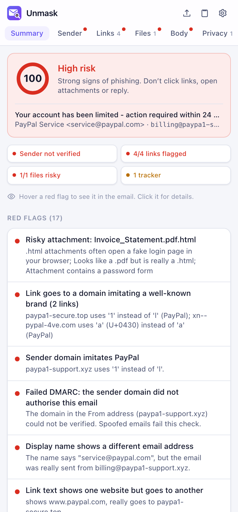
  &nbsp;
  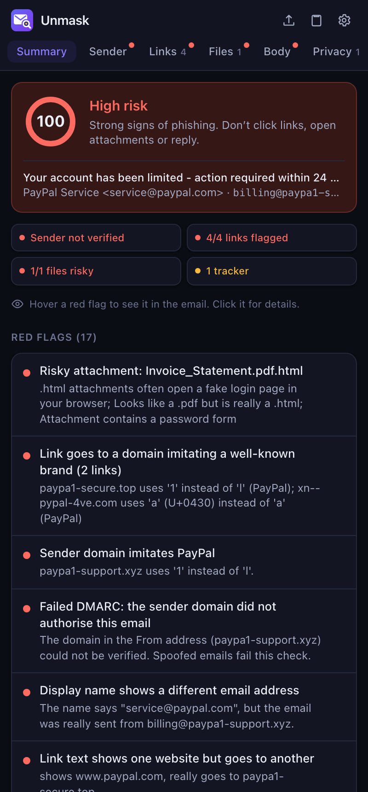
  &nbsp;
  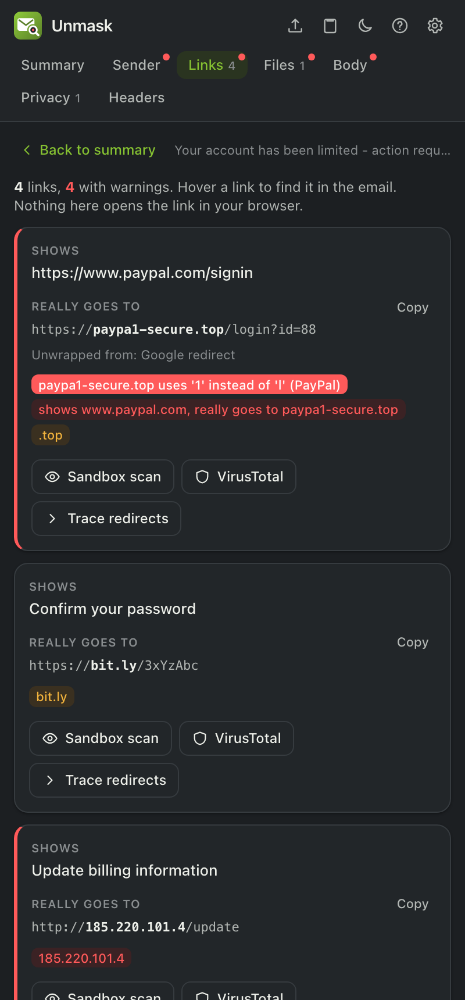
</p>

## See it in action

**It stops the click.** Gmail shows `https://www.paypal.com/signin`, but the link really goes to `paypa1-secure.top`. Unmask catches it before the page opens and says why, in plain words.

**It warns you inside your inbox, without opening anything.** Risky emails get a banner with the main reasons; risky senders get a badge in the email list.

<p align="center">
  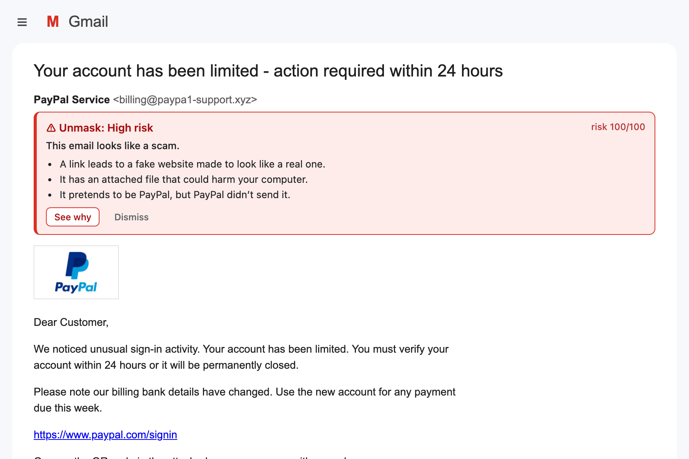
  &nbsp;
  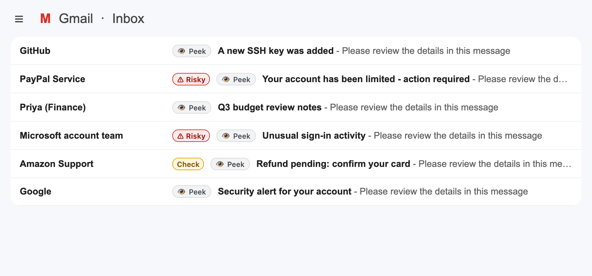
</p>

**It checks emails before you open them.** Click **👁 Peek** on any inbox row: Unmask checks the email and shows a text-only preview, without opening it, so its trackers never learn you looked. Explanations come in plain words, and a shareable protection list puts your own bank and boss first.

<p align="center">
  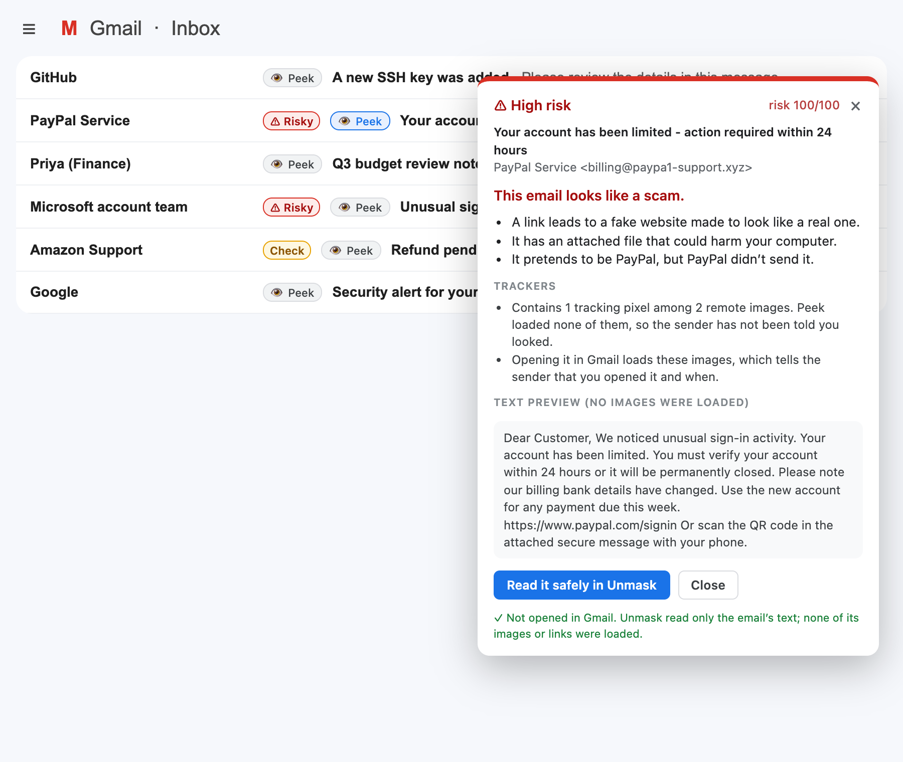
  &nbsp;
  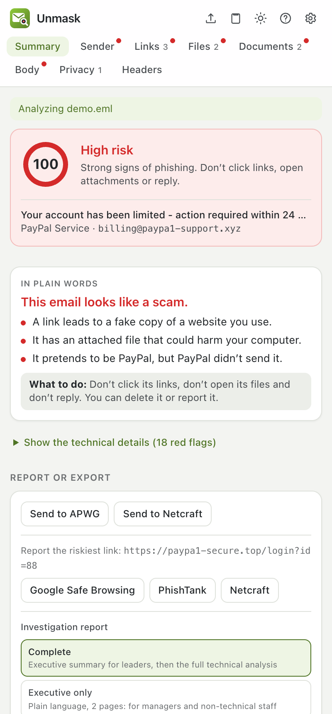
</p>

**It catches replies going to the scammer** and QR codes hidden in PDFs, and it looks inside attachments without opening them.

<p align="center">
  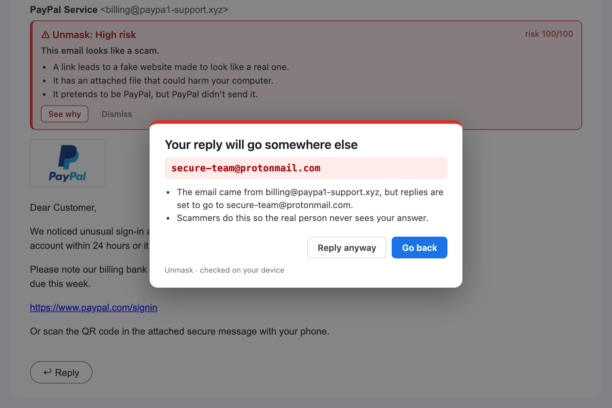
  &nbsp;
  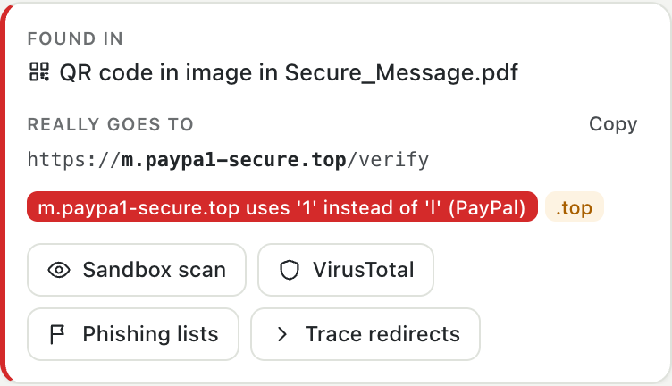
</p>

<p align="center">
  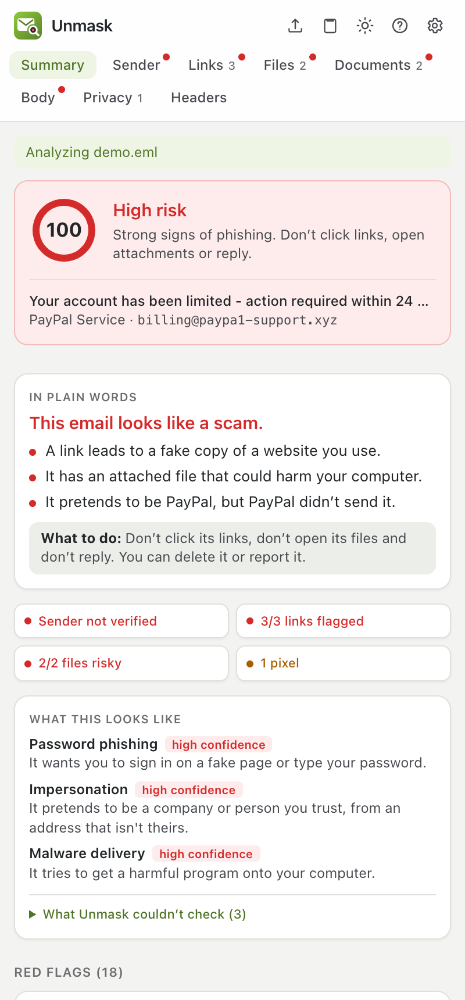
  &nbsp;
  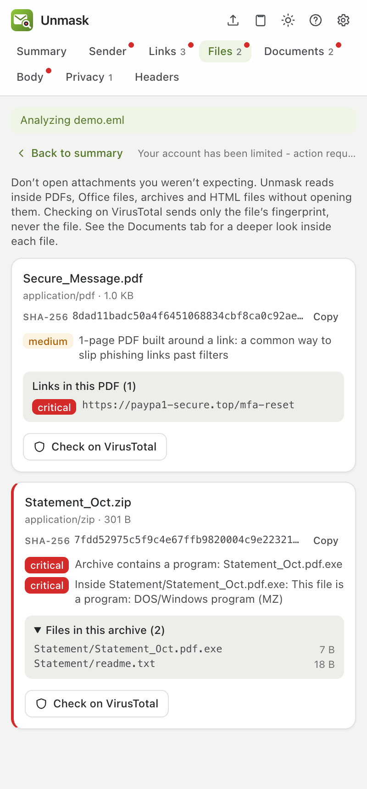
  &nbsp;
  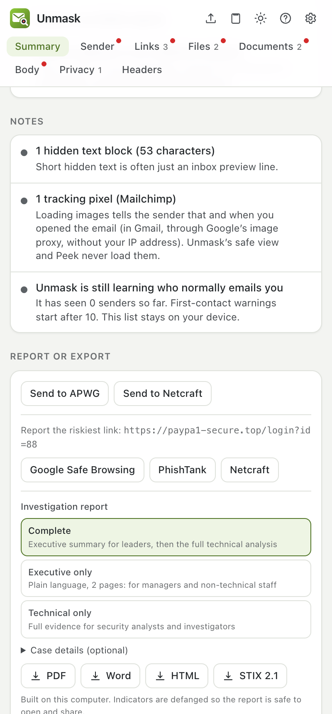
</p>

## What it does

Unmask works in **Gmail** and **Outlook on the web**, in **Chrome, Edge, Brave and Firefox**. As soon as you open an email it warns you inside your inbox: a red or amber banner above risky emails, a badge next to risky senders in the list, *"Wait, this goes to paypa1-secure.top"* before a dangerous link opens, and a warning when Reply would go to a different address.

Click the Unmask icon for the full report. The side panel shows:

- **A risk score from 0 to 100** with a verdict: *High risk*, *Suspicious* or *No red flags found*.
- **Every red flag in plain language**, for example *"The name says service@paypal.com, but the email was really sent from billing@paypa1-support.xyz."*
- **Where each link really goes**, with redirect wrappers removed, and buttons to see the final page in a sandbox.
- **Attachment checks**, including files pretending to be something else (`Invoice.pdf.html`), and a **Documents** tab that looks *inside* PDFs, Word, Excel, PowerPoint and RTF files, entirely on your computer. Files are never uploaded.
- **Hidden text and tracking pixels** the sender didn't want you to see.
- **"You've never received mail from paypa1-support.xyz. Your PayPal emails usually come from paypal.com."** Unmask remembers, only on your device, who normally emails you.
- **Report it in one click** to Gmail, APWG, Netcraft, Google Safe Browsing or PhishTank, or export an **investigation report** (PDF, Word, HTML or STIX) with a plain-language summary for leaders and a detailed technical part for security teams.

**Hover any red flag, link, or URL in the plain text and Unmask outlines that exact part of the email in Gmail.** Click a red flag to jump to the details, then use **Back to summary** to return. Switch between light, dark and system themes from the header.

<p align="center">
  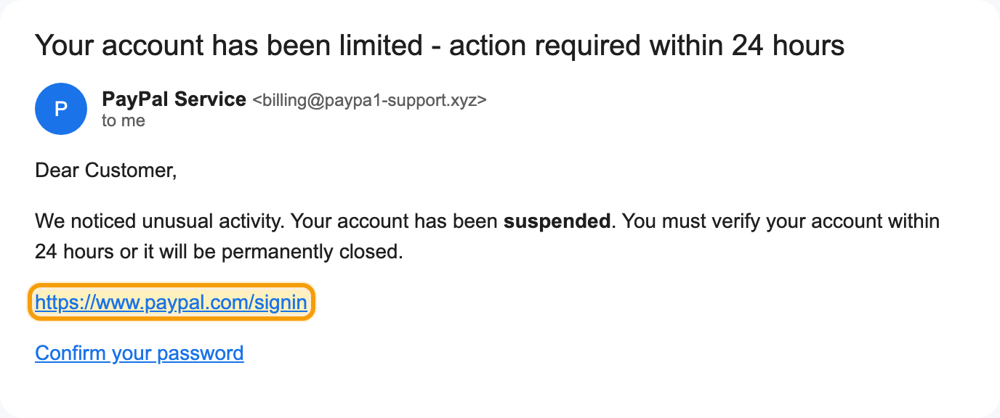
  &nbsp;
  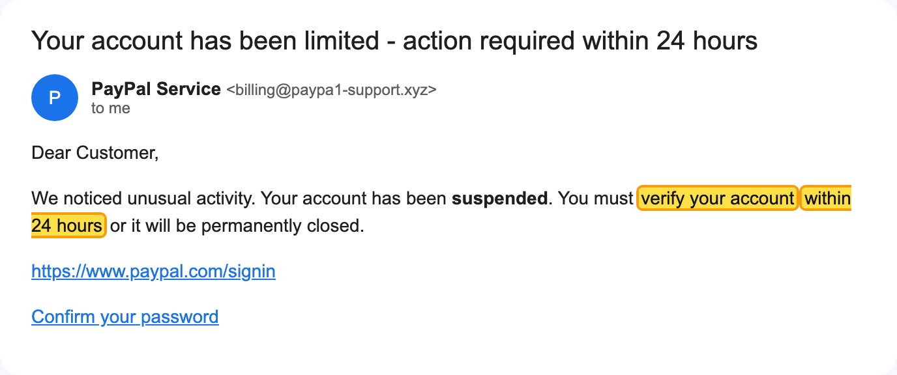
</p>

Using another mail app? Save the email as an `.eml` file and drop it on the panel, or paste its raw source.

## Proven on real phishing

> **Tested on 400 real phishing emails** from the public [phishing_pot](https://github.com/rf-peixoto/phishing_pot) research collection (bank, crypto-wallet, tax-refund, prize and invoice scams in many languages):
>
> 🏆 **346 caught (86.5%)** as Suspicious or High risk, up from 343 before this release
> 🏆 **285 rated High risk**, each with the reasons in plain language
> 🏆 **0 errors**, none slower than 0.13 seconds, all on one computer
>
> The misses were read and turned into new checks (invisible variation selectors, look-alike letters, crypto-wallet brands). **[See the report Unmask produces for a real phish](docs/REPORTS.md#real-examples)**: a fake Binance withdrawal, a fake COLDCARD advisory and a fake gift-card survey, each with the executive summary and the technical analysis.

<p align="center">
  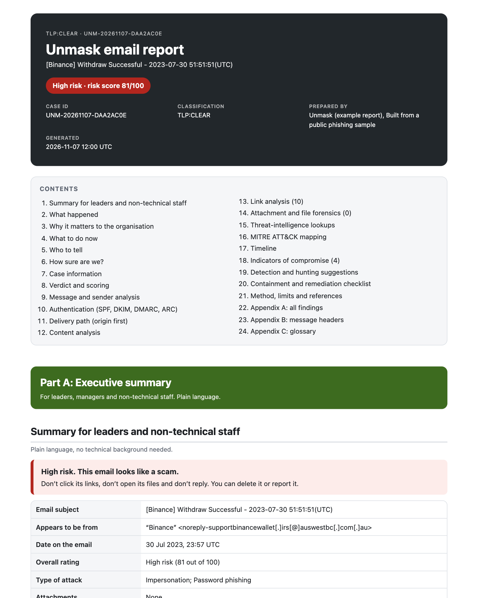
  &nbsp;
  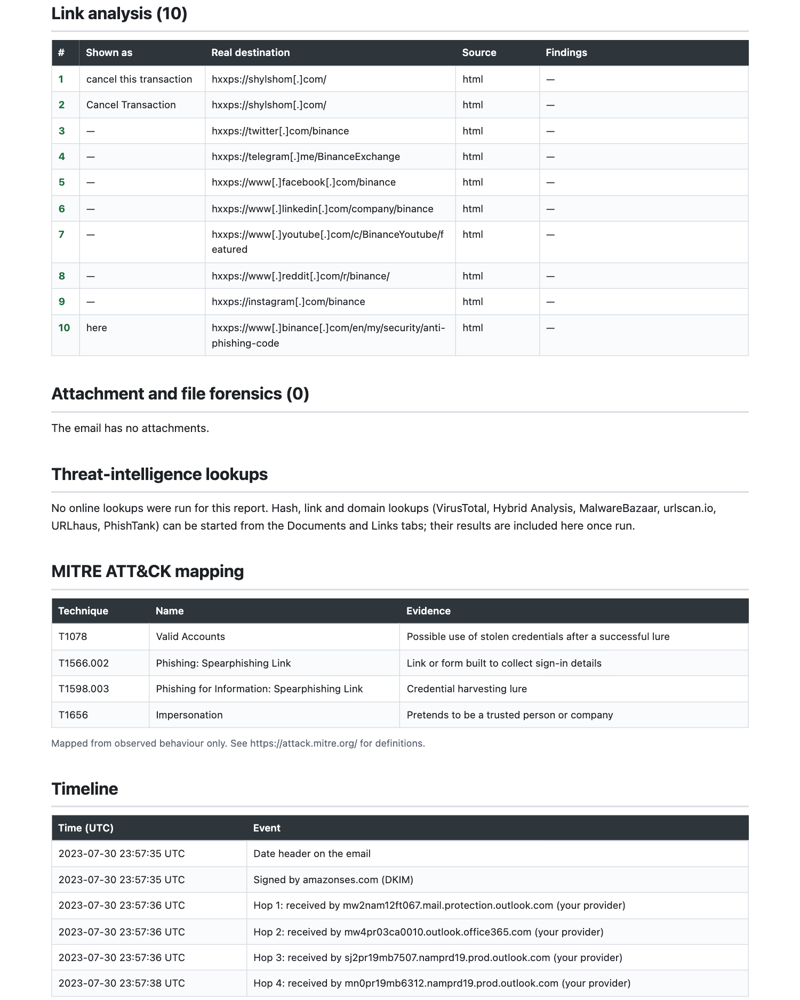
</p>

## Look inside files, and report it properly

<table>
<tr>
<td width="50%" valign="top">

### Documents tab: look inside every attachment

Unmask reads each attachment as raw bytes, **never opening or uploading it**. It counts the risky keywords in a PDF (the `pdfid` view), finds hidden JavaScript and the actions that run when a file opens, unpacks compressed object streams, reads Word macros and flags remote templates, reads spreadsheets' hidden sheets and Excel 4.0 macros, and extracts **every link**, with the text people click. Findings are explained in everyday words and tagged with MITRE ATT&CK techniques.

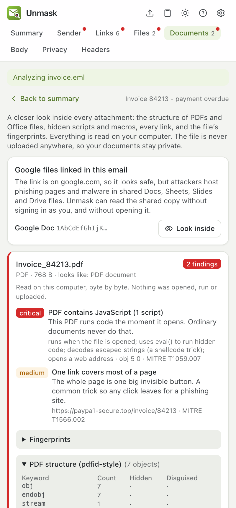

</td>
<td width="50%" valign="top">

### Macros and remote templates

Word and Excel files are taken apart: the VBA macro source is decompressed, auto-run entry points and what the code can do are listed, and a template fetched from the internet (template injection) is flagged along with "Enable editing" lure text.

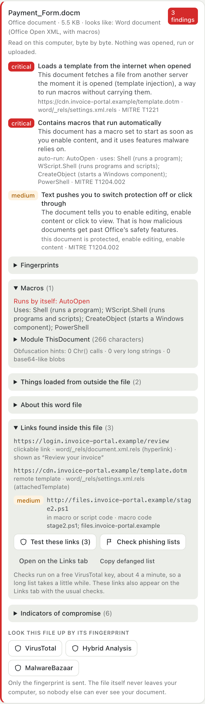

</td>
</tr>
<tr>
<td width="50%" valign="top">

### Your files stay private

Only a file's **fingerprint** (hash) is ever sent, and only when you click: to VirusTotal, Hybrid Analysis or MalwareBazaar. There is no upload button, so nobody else can find your documents. Every link inside a file can be tested, including against PhishTank and URLhaus.

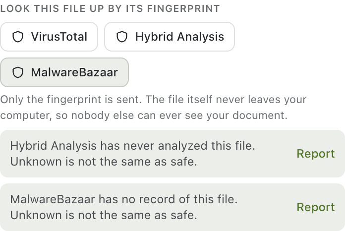

</td>
<td width="50%" valign="top">

### Shared Google Docs, read safely

A link on `docs.google.com` looks safe, but attackers host phishing there. Unmask can read a publicly shared Doc, Sheet, Slides or Drive file **anonymously** (not signed in as you), then analyse it like any attachment.

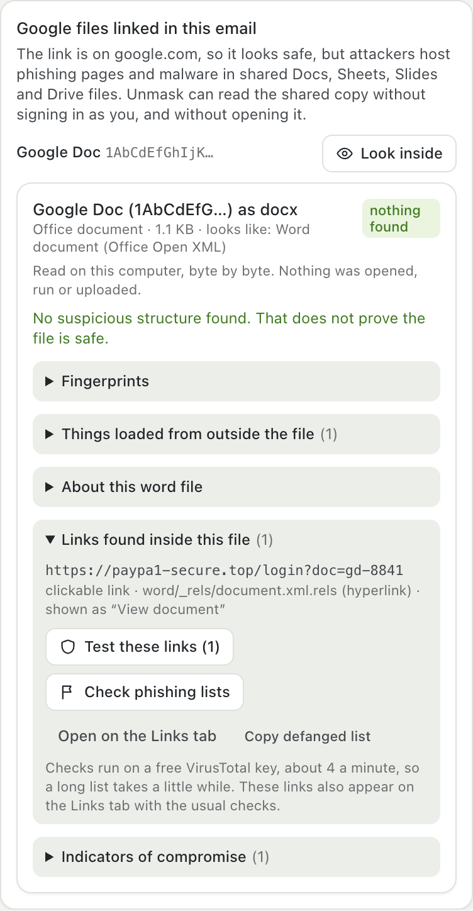

</td>
</tr>
<tr>
<td colspan="2" valign="top">

### Reports for leaders and for investigators

One report, two audiences: **Part A** is plain language (what happened, the business risk, what to do, who to tell); **Part B** is the full technical analysis (authentication, delivery path, file forensics, ATT&CK mapping, defanged indicators, hunting queries, a containment checklist). Export it as **PDF**, **Word**, **HTML** or **STIX 2.1**.

<p align="center">
  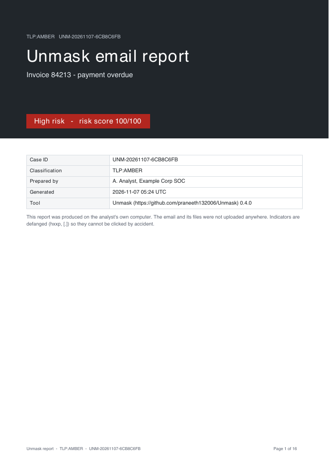
  &nbsp;
  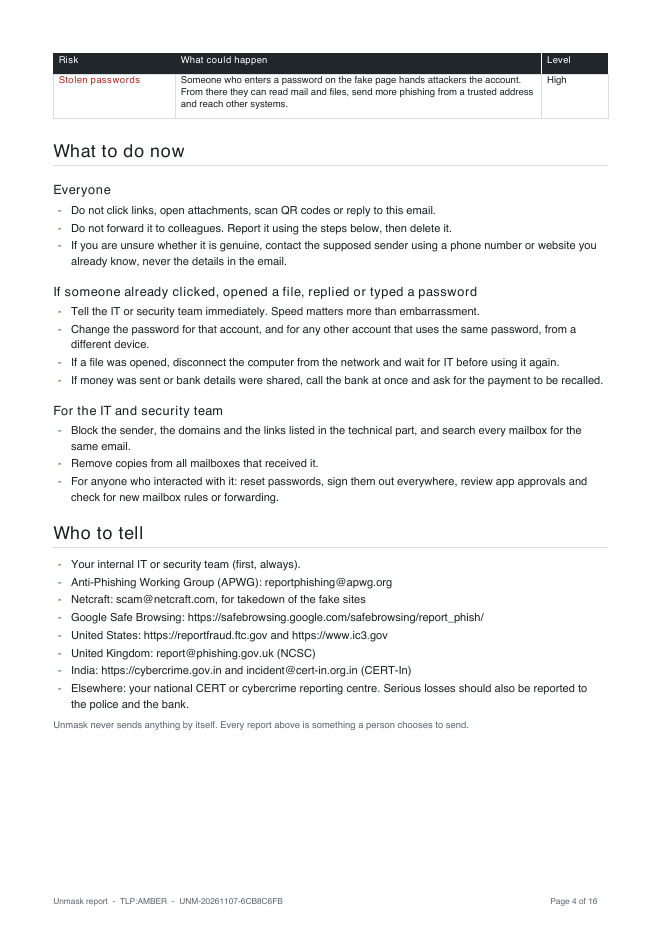
  &nbsp;
  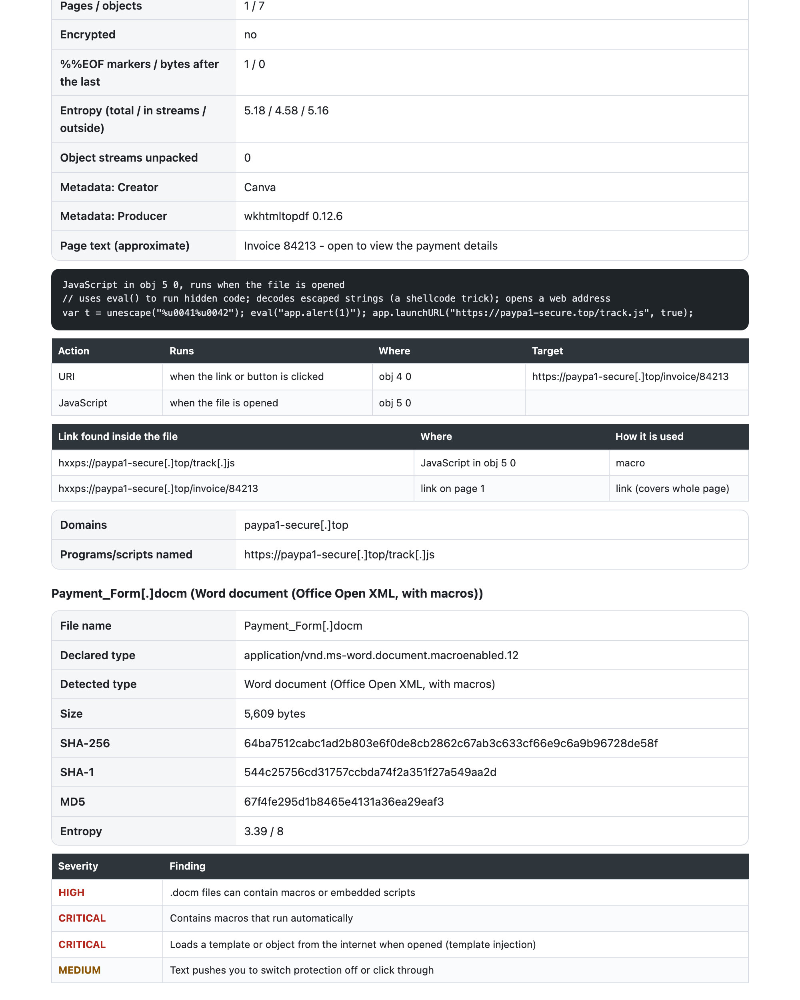
</p>

How it works: [File forensics](docs/FILE_FORENSICS.md) · [Reports](docs/REPORTS.md)

</td>
</tr>
</table>

## Highlights

| | |
|---|---|
| **Sender checks** | SPF, DKIM and DMARC; display names that hide another address; look-alike domains such as `paypa1.com` or `pаypal.com` (Cyrillic а) for 50+ brands, using Unicode's confusables list; brand names sent from free webmail; Reply-To and bounce addresses elsewhere; brand-new domains. |
| **Header forensics** | Verifies DKIM signatures itself (fetches the signer's key; RSA and Ed25519) and recomputes body hashes to catch emails changed after signing, headers added on top of signed ones and `l=` tricks. Reads the delivery path the way an analyst does, trusting only your provider's hops; spots fake "passed" stamps, DKIM replay of genuine emails, broken ARC chains, Gmail/Outlook senders whose Message-ID was made elsewhere, spam tools and workstation senders. |
| **Attack techniques** | Callback ("TOAD") scams, genuine PayPal/DocuSign/Google notifications carrying a scammer's text, device-code and OAuth consent lures, ClickFix "paste this command" instructions, locked ZIPs sent with their password, phishing-kit links carrying your address, image-only emails. |
| **Sender fingerprints** | Learns how each sender's emails are signed, routed and built, and warns when a known sender suddenly sends differently, such as a first-ever Reply-To elsewhere. |
| **Analyst write-up** | Says what kind of attack it is (with a confidence) and what couldn't be checked; one click copies a SOC-style case write-up or a defanged indicator list. |
| **Where the trackers are** | Each tracking pixel's service, address, and exact spot ("image 2 of 2, at the very end, after '…Unsubscribe'"), tagged in the safe view and in Gmail. Pixels are never loaded. |
| **Peek before opening** | Checks an inbox email without opening it; text-only preview, no trackers. Optional automatic checks of unread mail. |
| **Plain words** | Every verdict in one everyday sentence with what to do; simple mode for non-technical users. |
| **Protection list** | Your bank, your boss and trusted senders: impostors get critical warnings. Export/import to protect a whole family or team. |
| **Sender history** | First-contact warnings, "your PayPal emails usually come from paypal.com", and a contact's name used from another address. Kept only on your device. |
| **Payment fraud (BEC)** | Changed bank details, payment and wire requests, gift-card asks, and "are you available? keep this confidential" openers. |
| **QR codes** | Decodes QR codes in images and PDFs and checks where they really go. |
| **Fake logos** | An email showing PayPal's logo that PayPal didn't send, by asset host, alt text or image fingerprint. |
| **Domain intelligence** | Brand-new TLS certificates (Certificate Transparency) and domains without mail records (DNS), from free public sources. |
| **Link checks** | Text that shows one site but links to another; Google, Microsoft Safe Links and Proofpoint wrappers removed; IP addresses, punycode, `user@host` tricks, shorteners, free hosting, risky endings like `.top`. |
| **File forensics** | PDF keyword counts and objects (`pdfid`/`pdf-parser` style), JavaScript and auto-run actions, hidden object streams, VBA macros and Excel 4.0 sheets, remote templates, embedded files, RTF exploit objects, nested archives, every link with its visible text, and local hashes. See [File forensics](docs/FILE_FORENSICS.md). |
| **Investigation reports** | Executive and technical parts in PDF, Word, HTML and STIX 2.1, with defanged indicators, ATT&CK mapping and hunting queries. See [Reports](docs/REPORTS.md). |
| **Threat intelligence** | Hash-only lookups on VirusTotal, Hybrid Analysis and MalwareBazaar; link lookups on PhishTank and URLhaus. Files are never uploaded. |
| **Attachment checks** | Executables, disk images, HTML/SVG attachments, macro documents, double extensions, right-to-left filename tricks, password-protected ZIPs. Looks inside: links hidden in PDFs, macros and remote templates in Office files, the file list of ZIPs, and a safe preview of HTML attachments. |
| **Body checks** | Invisible text used to fool spam filters, forms and password fields inside the email, pressure and urgency phrases. A safe view with scripts off, links disabled and remote images blocked. |
| **Privacy** | Tracking pixels and click-tracked links from ~40 services (Mailchimp, HubSpot, Mailtrack, Superhuman, …). |
| **Optional online checks** | VirusTotal for files and links, urlscan.io for a sandbox screenshot of where a link lands, and a self-hosted server that traces redirect chains. Each one is set up from inside the panel. |

See [docs/CHECKS.md](docs/CHECKS.md) for every check and how many points it adds. Every check is measured against a [labelled corpus](extension/tests/fixtures/corpus) of phishing and legitimate emails in CI.

## Install

### Option 0: Chrome Web Store (easiest)

**[Install Unmask from the Chrome Web Store](https://chromewebstore.google.com/detail/unmask-%E2%80%94-phishing-email-i/bcogajaabcenbcbfbcgfjmccjdlfklcc)** and click **Add to Chrome**. It works in Google Chrome, Edge and Brave. **Firefox:** [install Unmask from Firefox Add-ons](https://addons.mozilla.org/en-US/firefox/addon/unmask-phishing-inspector/) and click **Add to Firefox**. While the extension is new, Chrome may show *"not trusted by Enhanced Safe Browsing"*; this is Chrome's standard notice for new publishers, and you can click **Continue to install**.

Prefer to load it yourself? Use one of the options below. It takes about two minutes.

### Option 1: No-code install (recommended)

1. Open the **[latest release](https://github.com/praneeth132006/Unmask/releases/latest)** and, under **Assets**, download **`unmask-chrome-<version>.zip`** (for example `unmask-chrome-0.2.1.zip`). Not "Source code".
2. **Unzip it.** You get a folder named `unmask-chrome-<version>` containing `manifest.json`. Move it somewhere permanent, such as **Documents**: Chrome loads Unmask from this folder.
3. Open **`chrome://extensions`** in the address bar and turn on **Developer mode** (switch in the top-right corner).
4. Click **Load unpacked** and select the unzipped folder, the one that directly contains `manifest.json`.
5. Click the puzzle-piece icon in Chrome's toolbar and **pin Unmask**.
6. **Reload Gmail**, open an email, and click the Unmask icon.

Stuck? The [user guide](docs/USER_GUIDE.md#1-install) covers common errors (such as *Manifest file is missing*) and how to update without losing your settings.

### Option 2: Build from source

**You need:** [Node.js](https://nodejs.org) 20 or newer and [pnpm](https://pnpm.io/installation).

```bash
git clone https://github.com/praneeth132006/Unmask.git
cd Unmask
pnpm install
pnpm build
```

Then follow steps 3–6 above, selecting the **`build/unmask-chrome`** folder inside the project.

The [user guide](docs/USER_GUIDE.md) walks through each step, explains every part of the report, and covers troubleshooting.

## Optional: extra checks

Unmask works with no setup at all. These free services add extra checks you run with a button:

| Service | What it adds | Free limit | Setup |
|---|---|---|---|
| **VirusTotal** | Checks attachments (by fingerprint) and links against 70+ antivirus engines | 4 lookups/min, 500/day | Click **Check on VirusTotal** on any file or link and follow the 3 steps in the panel |
| **urlscan.io** | Opens a link in urlscan's sandbox browser and shows a screenshot of where it lands | 50 private scans/day (Unmask only runs private scans) | Click **Sandbox scan** on any link and follow the steps |
| **Redirect tracing** | Follows a link's redirects without opening it | Free, unlimited | Built in: click **Trace redirects** and allow once. A self-hosted server is optional ([docs/BACKEND.md](docs/BACKEND.md)) |

**Free keys can never be charged.** Going over a limit just pauses that check until the quota resets. Paid plans exist only for heavy or commercial use: see **[Free limits and costs](docs/LIMITS_AND_COSTS.md)** for every number and price.

<p align="center">
  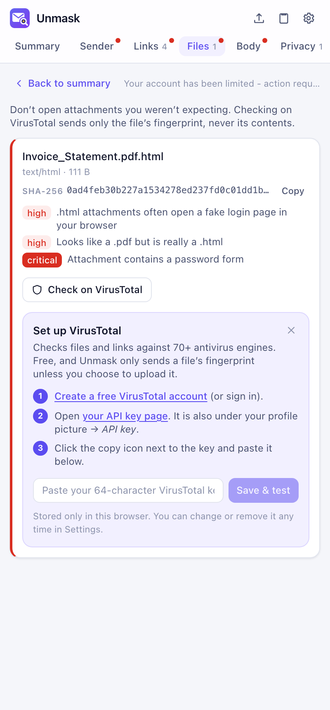
  &nbsp;
  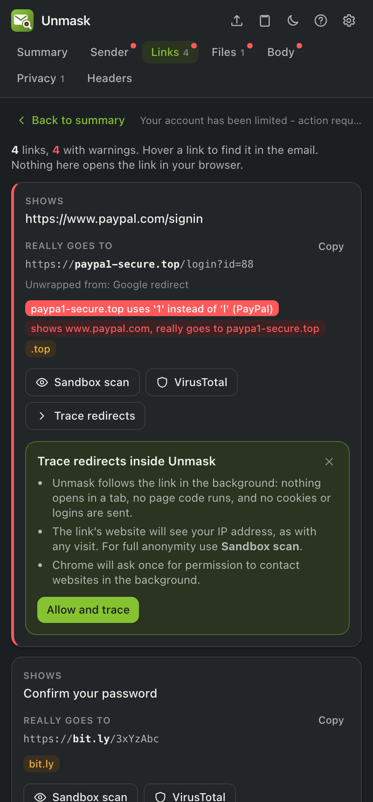
</p>

## Privacy

- The email is analyzed **inside your browser**. It is never sent to an Unmask server.
- Online checks run only when you click them, and send the minimum: a link, or a file's fingerprint (not the file).
- Files are never uploaded anywhere. Lookups use a file's hash only, so nobody else can see your documents.
- API keys are stored only in your browser.

Full details: [PRIVACY.md](PRIVACY.md).

## For developers

```bash
pnpm dev         # extension with hot reload (opens a Chrome window)
pnpm test        # extension and backend test suites
pnpm typecheck
pnpm backend     # redirect-trace server on http://localhost:8787
pnpm build       # production build into build/unmask-chrome
```

- [docs/ARCHITECTURE.md](docs/ARCHITECTURE.md): how the parts fit together, how the Gmail message is read, the highlight bridge, and the security model.
- [CONTRIBUTING.md](CONTRIBUTING.md): project layout, adding a check or a brand, testing, and commit style.
- [CHANGELOG.md](CHANGELOG.md): what changed in each version.

## Limitations

- Automatic detection works in **Gmail on the web**. Other mail apps work through `.eml` files or pasted source.
- Gmail changes its page structure from time to time. If Unmask stops finding the open email, use the `.eml` fallback and [open an issue](https://github.com/praneeth132006/Unmask/issues).
- Heuristics give false positives and miss some attacks. **Treat the score as advice, never as a guarantee.**

## Community

- Questions and bugs: [open an issue](https://github.com/praneeth132006/Unmask/issues/new/choose). There's a template for wrong verdicts.
- Contributing: see [CONTRIBUTING.md](CONTRIBUTING.md) and the [code of conduct](CODE_OF_CONDUCT.md).
- Security problems: report privately, see [SECURITY.md](SECURITY.md).

## Support Unmask

Unmask is free for everyone, including companies and schools, and has no ads, accounts or tracking. If it saved you from a scam, you can [sponsor its development on GitHub](https://github.com/sponsors/praneeth132006). It pays for time spent on new checks and fixing false alarms. Telling a friend or leaving a store review helps just as much.

## License

Unmask is free software under the [MIT licence](LICENSE). The release zip includes `LICENSE.txt` and `THIRD_PARTY_LICENSES.txt` for the open-source libraries it bundles (React, postal-mime, tldts, punycode).
