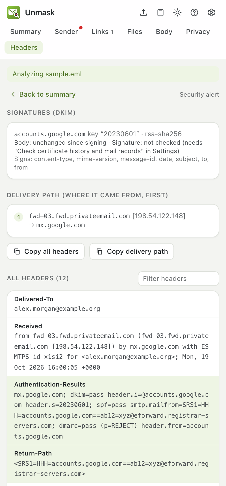
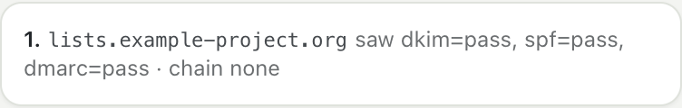
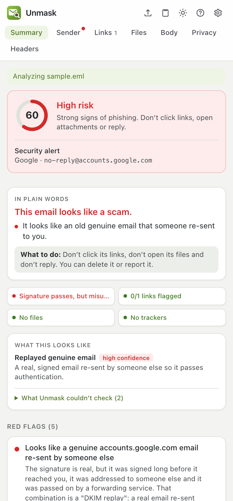
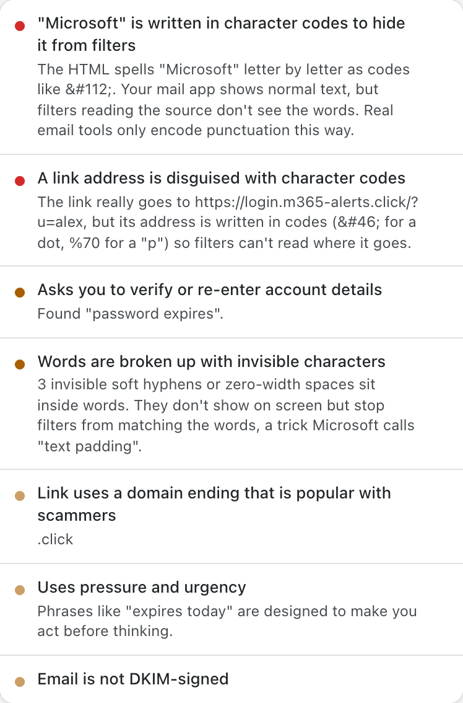
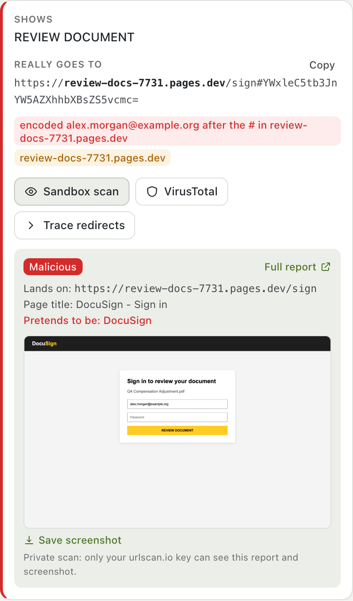
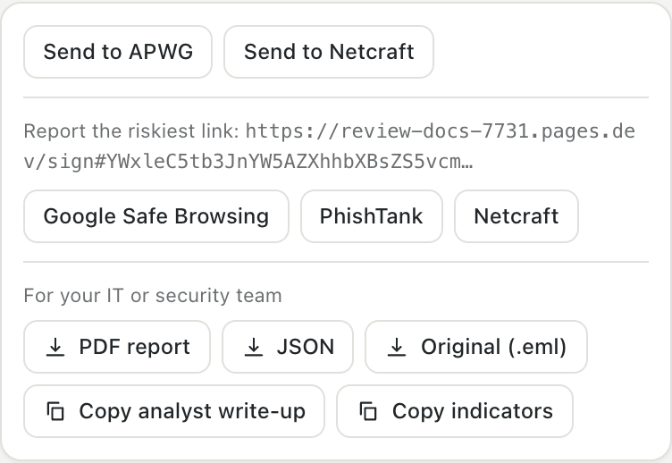

# How Unmask analyses an email

This page explains, step by step, what Unmask does with an email, why, and how it reports what it found. It follows the order a security-operations (SOC) analyst works in when a suspicious email is reported: preserve the original, read the headers, verify the sender, inspect links and files, judge the intent, then write it up.

For the exact list of checks and their points, see [What Unmask checks](CHECKS.md). For what leaves your computer, see the [privacy policy](../PRIVACY.md).

- [1. Getting the original email](#1-getting-the-original-email)
- [2. Parsing, byte for byte](#2-parsing-byte-for-byte)
- [3. The delivery path](#3-the-delivery-path)
- [4. Who checked the sender: Authentication-Results](#4-who-checked-the-sender-authentication-results)
- [5. DKIM signatures, checked by Unmask itself](#5-dkim-signatures-checked-by-unmask-itself)
- [6. Forwarding (ARC) and replayed emails](#6-forwarding-arc-and-replayed-emails)
- [7. How the email was built](#7-how-the-email-was-built)
- [8. The sender's identity and look-alike names](#8-the-senders-identity-and-look-alike-names)
- [9. The sender's domain and server (online)](#9-the-senders-domain-and-server-online)
- [10. The body: hidden text and encoding tricks](#10-the-body-hidden-text-and-encoding-tricks)
- [11. Links, and where they really land](#11-links-and-where-they-really-land)
- [12. Attachments, QR codes and logos](#12-attachments-qr-codes-and-logos)
- [13. Attack techniques](#13-attack-techniques)
- [14. What Unmask remembers about senders](#14-what-unmask-remembers-about-senders)
- [15. Scoring and the verdict](#15-scoring-and-the-verdict)
- [16. What this looks like, and what wasn't checked](#16-what-this-looks-like-and-what-wasnt-checked)
- [17. Reporting](#17-reporting)
- [18. What is sent where](#18-what-is-sent-where)
- [19. How the analysis is tested](#19-how-the-analysis-is-tested)

---

## 1. Getting the original email

Analysts never judge a phish from how it looks on screen; they pull the original message with every header. Unmask does the same.

| Where | How Unmask gets the email | Headers available |
|---|---|---|
| **Gmail** | Downloads the message's original source from Gmail ("Show original"), using your own Gmail session in that tab. Nothing goes through an Unmask server. | All of them |
| **Outlook on the web** | Outlook doesn't give pages the original source, so Unmask reads the open email from the page. | None. Paste *View message source* into the panel for header checks |
| **A file or pasted source** | Drop an `.eml` file on the panel or paste the raw source. | All of them, if the copy kept them |

Peek (in the Gmail inbox) downloads the source the same way without opening the email, so its tracking pixels never fire.

Source: [`lib/gmailRaw.ts`](../extension/src/lib/gmailRaw.ts), [`lib/outlookDom.ts`](../extension/src/lib/outlookDom.ts).

## 2. Parsing, byte for byte

The email is parsed twice:

1. **Decoded**, with [postal-mime](https://github.com/postalsys/postal-mime): MIME parts, quoted-printable and base64 bodies, attachments, display names. Every content check uses this.
2. **Byte-exact**, with Unmask's own splitter: the headers in their original order with their original folding, and the body exactly as transmitted. DKIM and ARC checks need the exact bytes that were signed; any decoding would break them. Gmail's "Show original" and copy-paste often lose the carriage return of each line ending; Unmask restores `CRLF` and says so when it had to.

Source: [`core/parse.ts`](../extension/src/core/parse.ts), [`lib/rawMessage.ts`](../extension/src/lib/rawMessage.ts).

## 3. The delivery path

Every mail server that handles an email adds a `Received` line **on top** of the others. So the lines are read **from the bottom up**: the bottom one is where the email started, the top one is your inbox.

The key rule analysts follow: **only the lines written by your own mail provider can be trusted.** Lines below the point where your provider took the email were written by servers you can't check, and a sender can write fake ones before sending.

Unmask parses each line (Postfix, Exim, Sendmail, Microsoft and Gmail formats) into: the name the sending server announced (HELO), the name your provider found for its IP (reverse DNS), the IP, the receiving server, the time, and the delay since the previous hop. It finds your provider from the top lines and marks every hop as *trusted* or *can't be verified*.

It then looks for:

- **Clocks running backwards** by more than 10 minutes. Over 6 hours, across an unverifiable line, is a sign of forged lines: the sender has to guess the times.
- **Mail handed to your provider straight from a computer** (`DESKTOP-…`, `localhost`, a bare IP), not a mail server.
- **A sending server with no DNS name.**
- **The Date header** much older than the arrival (a re-sent email) or in the future.

<p></p>

Source: [`analyzers/received.ts`](../extension/src/analyzers/received.ts).

## 4. Who checked the sender: Authentication-Results

When your provider receives an email it checks **SPF** (is this server allowed to send for the envelope domain?), **DKIM** (does the cryptographic signature verify?) and **DMARC** (does one of those match the domain in the From address you see?), and writes the results in an `Authentication-Results` header.

Two things go wrong in practice, and Unmask handles both:

1. **Several such headers.** Forwarders and gateways add their own. Unmask uses the one written by the provider that actually delivered the email to you (matched against the trusted hops), not simply the first.
2. **Fake ones.** A sender can write `Authentication-Results: mx.google.com; dmarc=pass` into the email before sending it. If a header names Google, Microsoft, Yahoo or Apple and that provider appears nowhere in the delivery path, Unmask reports a **fake "passed" stamp** and ignores it.

How each result is read:

| Result | What it means | What it doesn't mean |
|---|---|---|
| DMARC pass | The From domain authorised this email | That the domain is honest: scammers pass DMARC on domains they own, and hacked accounts pass too |
| DMARC fail | The From address is not backed by the domain | It could be a mailing list that changed the email |
| SPF pass | The sending server may send for the *envelope* domain | Anything about the From address you see |
| DKIM pass | The signed parts weren't changed since the signer signed them | Who wrote the text, or that it's safe |

Source: [`analyzers/auth.ts`](../extension/src/analyzers/auth.ts).

## 5. DKIM signatures, checked by Unmask itself

Your provider's DKIM verdict is a summary. Unmask also reads every `DKIM-Signature` and checks it.

**Locally, with no network:**

1. Rebuild the body exactly as the signer did (*simple* or *relaxed* canonicalization from [RFC 6376](https://www.rfc-editor.org/rfc/rfc6376): trailing whitespace, blank lines at the end, an `l=` length limit) and hash it with SHA-256 or SHA-1.
2. Compare with the signature's `bh=` value. **A mismatch means the body was changed after it was signed.**
3. Check what the signature covers (`h=`): a From that isn't signed, a Reply-To that isn't signed, and **headers added on top of signed ones**. Mail apps show the topmost Subject or From, while DKIM verifies the bottom one, so an attacker can add a second Subject to a genuinely signed email and it still passes.
4. Check the signing time (`t=`) and expiry (`x=`): a signature days older than the arrival is a sign of a replay.

**Online** (with *Check certificate history and mail records* on, the default):

5. Fetch the signer's public key from DNS (`selector._domainkey.domain`, over DNS-over-HTTPS; only that name is sent).
6. Rebuild the exact signed header data and verify the signature with the browser's WebCrypto: RSA-SHA256, RSA-SHA1 and Ed25519 ([RFC 8463](https://www.rfc-editor.org/rfc/rfc8463)).
7. Report headers edited after signing, signatures that name a key that doesn't exist (a fake "signed by PayPal"), withdrawn keys, keys under 1024 bits and keys in test mode. A signature your provider verified on arrival but that fails now is treated as a rotated key, not tampering.

The Headers tab lists every signature with its body result, signature result, key size and the headers it signs.

Source: [`lib/dkim.ts`](../extension/src/lib/dkim.ts), [`analyzers/dkim.ts`](../extension/src/analyzers/dkim.ts), [`integrations/dkimVerify.ts`](../extension/src/integrations/dkimVerify.ts). Tested against signatures made by [mailauth](https://github.com/postalsys/mailauth), an independent implementation.

## 6. Forwarding (ARC) and replayed emails

**ARC** ([RFC 8617](https://www.rfc-editor.org/rfc/rfc8617)) lets each forwarding server record the authentication results it saw, numbered and sealed. Unmask reads the chain's structure (every set present, the `cv=` statuses consistent) and what each server recorded. A DMARC failure on an email that passed at the first ARC hop means it was forwarded or re-sent in between. It doesn't verify the seals' signatures.

<p></p>

**DKIM replay** is the attack where a genuine signed email (often a notification the attacker triggered on their own account, with their lure in a field they control) is re-sent unchanged to many people. The signature still verifies and DMARC can pass. In 2025 attackers used this with genuine Google security alerts. Unmask combines the signs analysts look for, on an email signed by its From domain:

- signed or written days before it arrived
- addressed to someone other than you (not a mailing list or your own forwarding)
- passed at an earlier ARC hop and failed at yours
- passed on by a forwarding service (an SRS bounce address)
- SPF failed for an unrelated delivering server

Two signs make it high risk, three critical, and the *DMARC passed* reassurance is removed.

<p></p>

Source: [`analyzers/arc.ts`](../extension/src/analyzers/arc.ts), [`analyzers/replay.ts`](../extension/src/analyzers/replay.ts).

## 7. How the email was built

Each mail service builds emails its own way, and scam tools build them differently. Unmask compares the construction with the claimed sender:

- **Two From headers**: your mail app may show one while filters checked the other.
- **Message-ID**: Gmail, Outlook.com and Yahoo each write their own. A `gmail.com` From whose Message-ID came from a hosting server wasn't written in Gmail.
- **Sending software** (`X-Mailer`, `X-PHP-Originating-Script`): bulk spam tools, and scripts on websites (phishers often send from sites they broke into).
- **"Re:" with nothing it replies to**: real replies carry `In-Reply-To` or `References`; a made-up conversation doesn't.

Source: [`analyzers/identity.ts`](../extension/src/analyzers/identity.ts).

## 8. The sender's identity and look-alike names

- **Display names** that contain another address, or claim a brand that the sending domain doesn't belong to, or an organisation writing from free webmail.
- **Look-alike domains**: every domain is reduced to a *skeleton* using Unicode's own list of confusable characters ([UTS #39](https://www.unicode.org/reports/tr39/), about 1,600 characters from Cyrillic, Greek, Coptic, Cherokee, mathematical and full-width letters) plus digit swaps (`0→o`, `1→l`), `rn→m` and `vv→w`, then compared with 50+ frequently impersonated brands for exact look-alikes, one- or two-letter typos, and brand names inside other domains.
- **Disguised names**: a sender name or subject that mixes alphabets (`PаyPal` with a Cyrillic а) or hides zero-width characters.
- **Reply-To and bounce addresses** on other domains.

Source: [`analyzers/sender.ts`](../extension/src/analyzers/sender.ts), [`analyzers/lookalike.ts`](../extension/src/analyzers/lookalike.ts).

## 9. The sender's domain and server (online)

These need small public lookups; only names (and, optionally, one IP) are sent.

- **Domain age** from the official registry (RDAP), and **first TLS certificate** from Certificate Transparency logs: phishing domains are days old.
- **Mail records** over DNS-over-HTTPS: no MX, SPF or DMARC; SPF that lets **any** server send (`+all`); a DMARC `p=none` policy that lets fakes through; a certified **BIMI** logo as a good sign.
- **Who runs the sending server** (off by default): reverse DNS and network owner of the server that delivered the email (Team Cymru's public DNS zone), flagging home connections and rented servers.

Source: [`integrations/rdap.ts`](../extension/src/integrations/rdap.ts), [`integrations/domainIntel.ts`](../extension/src/integrations/domainIntel.ts), [`integrations/ipIntel.ts`](../extension/src/integrations/ipIntel.ts).

## 10. The body: hidden text and encoding tricks

The body is parsed into a document (scripts never run) and checked for forms and password fields, pressure language, requests to verify accounts, and **hidden text**: `display:none`, zero-size fonts, transparent text, text the colour of its background. Large amounts of hidden text are used to confuse spam filters.

**Encoding tricks.** Your mail app decodes the HTML before showing it; many filters read the raw source. Phishers exploit that gap:

| Trick | In the source | What you see | Why it works |
|---|---|---|---|
| **Numeric character references** | `&#80;&#97;&#121;&#80;&#97;&#108;` | PayPal | Filters searching for "paypal" don't find it |
| **Encoded link address** | `href="https://&#108;&#111;&#103;&#105;&#110;&#46;evil.top"` or `https://%70aypa1.top` | a normal link | Link filters can't read the host |
| **Invisible splitters** | `Pay&shy;Pal`, `pass&#8203;word` | PayPal, password | Soft hyphens and zero-width spaces break the word for filters; Microsoft calls this "text padding" |
| **Mixed alphabets** | `Micrоsoft` with a Cyrillic о | Microsoft | A different word to a computer |
| **Zero-size or hidden text** | `<span style="font-size:0">…</span>` | nothing | Pads the email with harmless words |

How Unmask detects them: it scans the raw HTML for numeric character references that decode to ordinary letters and digits (email tools only encode punctuation such as `&#39;` or `&#8217;`, so `&#39;` and `&nbsp;` are ignored), decodes `href` values and looks for codes or `%`-encoding in the host name, counts soft hyphens and zero-width characters *inside* words, and finds words mixing Latin with look-alike letters. Each is stronger when the decoded text spells a brand.

<p></p>

Source: [`analyzers/content.ts`](../extension/src/analyzers/content.ts), [`analyzers/obfuscation.ts`](../extension/src/analyzers/obfuscation.ts).

## 11. Links, and where they really land

Every link in the HTML, the plain text, inside attachments and decoded from QR codes is collected, then:

1. **Unwrapped locally**: Google redirects, Microsoft Safe Links, Proofpoint, Facebook, LinkedIn, Slack and generic `?url=` redirects are peeled off without contacting anything.
2. **Inspected**: text showing one site but linking to another, look-alike and brand-in-domain hosts, `user@host` tricks, IP addresses, punycode, shorteners, free hosting, risky endings, risky downloads, and **your address hidden in the link** (after the `#` or base64-encoded), which phishing kits use to pre-fill a fake login page.
3. **On request, followed safely**:
   - **Sandbox scan** (urlscan.io): urlscan's own browser opens the link, never yours. **Every scan is private**: only your API key can see the result, the screenshot and the page; it never appears in urlscan's public feed or search, or in urlscan Pro for its partners, and is deleted after your plan's retention period. Because private screenshots aren't public images, Unmask fetches the screenshot with your key and shows it in the Links tab, with **Save screenshot** to keep a copy. Where the link lands goes into the report.
   - **VirusTotal**: a lookup of what VirusTotal already knows publishes nothing. Submitting an unknown link for a fresh scan makes it visible to VirusTotal's customers, so Unmask asks first.
   - **Trace redirects**: follows the redirect chain without rendering the page, from the extension or your own server.

<p></p>

*(In this screenshot, urlscan.io and the landing page are local test doubles, so no real site was contacted.)*

Source: [`analyzers/links.ts`](../extension/src/analyzers/links.ts), [`lib/redirects.ts`](../extension/src/lib/redirects.ts), [`integrations/urlscan.ts`](../extension/src/integrations/urlscan.ts), [`integrations/virustotal.ts`](../extension/src/integrations/virustotal.ts).

## 12. Attachments, QR codes and logos

- **Attachments** are hashed (SHA-256) and read as bytes, never opened or run: executables and scripts, disk images, HTML/SVG login pages, macro documents, double extensions, right-to-left filename tricks, password-protected archives. Inside PDFs, Office files and ZIPs: links, JavaScript, launch actions, macros, remote templates, DDE and nested programs.
- **QR codes** are decoded from image attachments, inline images and images inside PDFs; each decoded link goes through every link check.
- **Brand logos** are recognised by asset host, alt text, file name and a perceptual image fingerprint: a PayPal logo in an email PayPal didn't send.

Source: [`analyzers/attachments.ts`](../extension/src/analyzers/attachments.ts), [`analyzers/documents.ts`](../extension/src/analyzers/documents.ts), [`analyzers/qr.ts`](../extension/src/analyzers/qr.ts), [`analyzers/logos.ts`](../extension/src/analyzers/logos.ts).

## 13. Attack techniques

Some attacks are recognised by their shape rather than a bad link or a failed check:

| Technique | What it looks like |
|---|---|
| **Callback scam ("TOAD")** | A charge, renewal or invoice, "if you didn't make this, call…", and a phone number. No link: the scam happens on the phone |
| **Abused notification platforms** | A genuine PayPal invoice, DocuSign envelope or Google share (DMARC passes) whose user-written text carries a callback number, a dangerous link or a webmail contact |
| **Device-code phishing** | "Go to microsoft.com/devicelogin and enter this code": the page is real, the code signs the attacker in |
| **OAuth consent lures** | A direct link to a Microsoft or Google app-permission page asking for mail or file access, or bouncing to an unrelated `redirect_uri` |
| **ClickFix** | "Press Windows + R, then Ctrl + V": pasting a command into the Run box, often as a fake CAPTCHA |
| **Locked archive with its password** | A password-protected ZIP (so scanners can't see inside) and the password in the email |
| **Payment fraud (BEC)** | Changed bank details, gift-card requests, "are you available? keep this confidential" |

Source: [`analyzers/techniques.ts`](../extension/src/analyzers/techniques.ts), [`analyzers/bec.ts`](../extension/src/analyzers/bec.ts).

## 14. What Unmask remembers about senders

On your device only, Unmask keeps who has emailed you, how often, and how each sender's emails are usually built: the DKIM signing domain, the mail service that delivered them, the Message-ID domain, the mail program and any Reply-To domain. This powers:

- **First contact** warnings, and "your PayPal emails usually come from paypal.com".
- **A contact's name** used from another address.
- **A changed fingerprint**: a sender you know who suddenly sends differently, especially one asking for replies to go elsewhere for the first time, the classic sign of a hacked supplier account.

High-risk emails and emails opened from files are never learned. Turn it off or forget everything in Settings → Privacy.

Source: [`analyzers/history.ts`](../extension/src/analyzers/history.ts), [`analyzers/fingerprint.ts`](../extension/src/analyzers/fingerprint.ts).

## 15. Scoring and the verdict

Every finding has a severity and points. The points add up to a score from 0 to 100:

- **0–19** *No red flags found* (or *Low risk* when there are minor notes) · **20–49** *Suspicious* · **50–100** *High risk*.
- Any **critical** finding, or two **high** ones, forces *High risk*.
- Reassuring findings (DMARC pass, a verified signature, a sender you know) can take off at most 15 points, and **nothing at all once there is a high or critical finding**: authentication proves who sent an email, not that it is safe.
- Online checks add their findings when they finish, and the score updates.

Source: [`core/score.ts`](../extension/src/core/score.ts).

## 16. What this looks like, and what wasn't checked

Like an analyst's case summary, the Summary names **the kind of attack** the red flags point to, with a confidence from the weight of the evidence: *Forged sender address*, *Impersonation*, *Password phishing*, *Account access trick*, *Malware delivery*, *Callback scam*, *Payment fraud*, *Replayed genuine email*, *Possibly a hacked account*.

Below it, **What Unmask couldn't check** lists this email's blind spots, so a clean result isn't mistaken for a guarantee: missing headers, signatures not verified with the signer's key, delivery steps written before your provider got the email, links checked by address only, files read but not run, remote images not loaded.

<p></p>

Source: [`core/assessment.ts`](../extension/src/core/assessment.ts).

## 17. Reporting

**Inside your inbox:** a red or amber banner above risky emails with the top reasons, badges next to risky senders in the list, *"Wait, this link goes to …"* before a risky link opens, and a warning when Reply would go to another address.

**In the panel:** the verdict in plain words, the red flags (hover one to outline it in the email), and seven tabs: Summary, Sender, Links, Files, Body, Privacy, Headers.

**Report or export** (nothing is sent automatically; every destination opens for you to review):

| Button | What it does |
|---|---|
| **Report in Gmail** | Opens Gmail's own *Report phishing* |
| **Send to APWG / Netcraft** | Downloads the original `.eml` and opens a pre-filled email to the reporting address; you attach the file and send |
| **Google Safe Browsing / PhishTank / Netcraft** | Opens the web form for the worst link (Google's pre-filled) |
| **PDF report** | Verdict, attack type, message details, authentication, every finding, defanged links, attachments and hashes, QR codes, what wasn't checked, and the delivery headers |
| **JSON** | Everything above, machine-readable, including the forensics (hops, DKIM signatures, ARC) and the indicators |
| **Original (.eml)** | The untouched source, for your security team |
| **Copy analyst write-up** | A plain-text case report in SOC order (below), ready for a ticket |
| **Copy indicators** | Sender, Reply-To, bounce address, origin IP, delivering server, signing domains, URLs, hosts, file hashes and callback numbers, one per line and **defanged** so none becomes a clickable link |

<p></p>

An analyst write-up for a DocuSign look-alike from the test corpus:

```text
# Phishing analysis: Please review and sign: Q4 Compensation Adjustment.pdf

## Verdict
High risk, risk score 60/100.
- Impersonation (high confidence): It pretends to be a company or person you trust, from an address that isn't theirs.
- Password phishing (medium confidence): It wants you to sign in on a fake page or type your password.

## Message
From: "DocuSign" <dse@docusign-secure-review.net>
To: alex.morgan@example.org
Message-ID: <a81@docusign-secure-review.net>

## Authentication
Provider verdict (mx.google.com): SPF pass (docusign-secure-review.net), DKIM pass (docusign-secure-review.net), DMARC pass (docusign-secure-review.net).

## Delivery path (origin first)
1. mail.docusign-secure-review.net [198.51.100.23] -> mx.google.com at 2026-10-19T16:00:05.000Z
2. internal step at your provider -> 2002:a05:7300:1234 at 2026-10-19T16:00:06.000Z (+1s)

## Findings (5 red flags)
- [HIGH +20] Sender domain imitates DocuSign
- [HIGH +18] Link carries an email address, hidden, for a pre-filled login page
- [MEDIUM +10] Display name uses the DocuSign brand
- [LOW +5] Uses pressure and urgency
- [LOW +5] Link goes to a free hosting or forms service (also popular with phishers)
- [GOOD -10] DMARC passed for docusign-secure-review.net

## Indicators (defanged)
sender        dse[@]docusign-secure-review[.]net
origin-ip     198[.]51[.]100[.]23
delivered-by  mail[.]docusign-secure-review[.]net [198[.]51[.]100[.]23]
url           hxxps://review-docs-7731[.]pages[.]dev/sign#YWxleC5tb3JnYW5AZXhhbXBsZS5vcmc=
host          review-docs-7731[.]pages[.]dev

## Not checked
- 1 link was checked by address only. What the page does is unknown until you run a sandbox scan from the Links tab.

## Recommended actions
- Do not click, reply or open files. Report it and delete it.
- Search other mailboxes for the sender, Reply-To, URLs and hashes above, and block them.
- If anyone clicked or replied: reset their password, revoke sessions and app consents, and check their mailbox rules.
```

Indicators use the exact host (`review-docs-7731.pages.dev`), never the shared platform (`pages.dev`), so blocking them doesn't block a whole hosting service.

Source: [`lib/reporting.ts`](../extension/src/lib/reporting.ts), [`ui/components/ReportCard.tsx`](../extension/src/ui/components/ReportCard.tsx).

## 18. What is sent where

Everything in steps 2–8 and 10–16 runs on your computer. The online steps send the minimum, and only to the service named:

| Step | Sent | To | Public? |
|---|---|---|---|
| Domain age | The sender's domain | rdap.org and the registry | No |
| Certificates | The sender's and up to 3 link domains | crt.sh | No |
| Mail records, DKIM keys | Domain names and `selector._domainkey` names | dns.google | No |
| Sending server (off by default) | The delivering server's IP | dns.google | No |
| Sandbox scan (on click) | One link | urlscan.io, **private scan** | **No**: only your key can see it |
| VirusTotal lookup (on click) | A link or a file hash | VirusTotal | No: a lookup publishes nothing |
| VirusTotal submit or upload (on click, after a warning) | A link or a file | VirusTotal | **Yes, to VirusTotal's customers**, which the warning says |
| Trace redirects (on click) | One link | the link's sites, or your own server | No |

The email itself (headers, body, attachments) is never sent to Unmask's developers or to any Unmask server. Full details: [privacy policy](../PRIVACY.md).

## 19. How the analysis is tested

- **Unit tests** for every analyzer (420+). DKIM and ARC are tested against real signatures and seals made by [mailauth](https://github.com/postalsys/mailauth), an independent implementation, for every canonicalization and for RSA and Ed25519.
- **A labelled corpus** in [`extension/tests/fixtures/corpus`](../extension/tests/fixtures/corpus): phishing emails modelled on published write-ups (CEO gift cards, a DocuSign look-alike with a pre-filled login, PayPal invoice and Geek Squad callback scams, device-code phishing, ClickFix, a locked ZIP with its password, a forged Google stamp, an HTML login attachment, a fake reply changing bank details, a replayed Google alert, entity-encoded Microsoft 365 phishing) and legitimate emails built like the real thing (a personal reply, an Amazon order and a Chase fraud alert with phone numbers, a Google Docs share, a Microsoft security code, a mailing-list post that broke DKIM, newsletters with encoded tracking links). **Every phish must be rated High risk as the right kind of attack, and every legitimate email must come out clear.**
- **End-to-end tests** load the built extension in Chromium against a Gmail test double, in both the normal and the fallback parsing mode.
- **CI** runs all of it, plus the Chrome, Firefox and Edge builds, on every push; `main` only moves when it's green.
