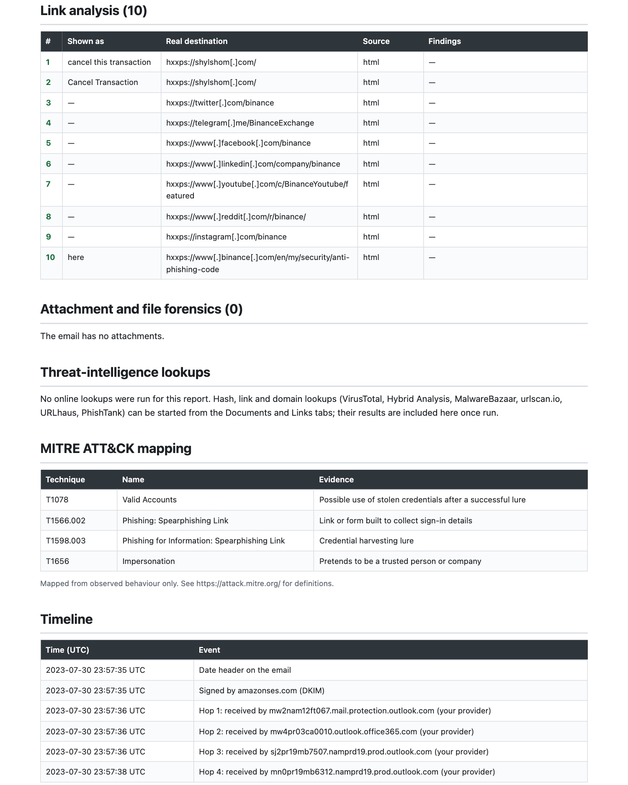
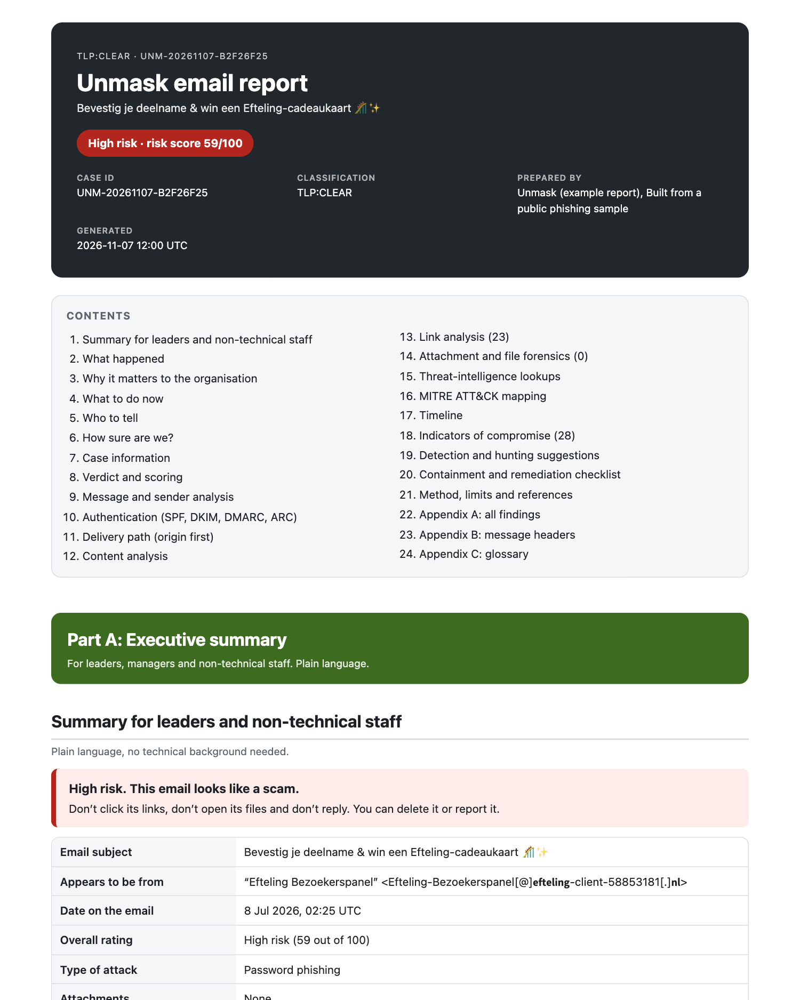

# A report for a real phishing email

These reports were built by Unmask from **real phishing emails** in the public [phishing_pot](https://github.com/rf-peixoto/phishing_pot) research collection. Nothing was staged: each email was analysed exactly as it arrived, and the report was exported with the standard **Complete** option. Only the analysis is published: the original emails are not redistributed, and every indicator is defanged so the reports are safe to open.

Each report has **Part A**, a plain-language summary for leaders and non-technical staff, and **Part B**, the full technical analysis for security teams. Open the HTML version in your browser or download the PDF.

> **Tested on 400 real phishing emails from this collection: 346 caught (86.5%), 285 of them rated High risk, no failures.** See [how that was measured](../CONTRIBUTING.md).

## 1. A fake Binance "withdrawal successful" email

**High risk, 81 out of 100.** A message pretending to be Binance announces a withdrawal and offers a "Cancel this transaction" button: the classic panic lure.

What Unmask found, in the report's own words:

- It claims to be **Binance but is not sent from Binance's domain** (it comes from `auswestbc[.]com[.]au`), yet shows the real Binance logo, loaded from Binance's servers.
- It was **sent by a script (PHPMailer)**, not by a company mail system.
- The whole message is **one clickable picture** with almost no text, so spam filters cannot read it, plus 602 characters of hidden text.
- The **Cancel Transaction** links go to a different website from `binance.com`.
- A genuine **DKIM signature from the mailing service passes**, which is why a simple check would have trusted it. Unmask notices it is signed by a different domain than the From address.

  
  &nbsp;
  

**[Open the HTML report](examples/binance-withdrawal.html)** · **[Download the PDF](examples/binance-withdrawal.pdf)**

## 2. A fake COLDCARD "security advisory"

**High risk, 60 out of 100.** An email in the name of a hardware-wallet maker tells owners to book a "10-minute call" through a link to collect a "refund". It passes DMARC, because the scammers own the look-alike domain.

- The **sender domain imitates the brand** (`coldcardblog[.]org` contains "coldcard" but is not theirs), and so does the **link domain** (`book.coinkiteadvisory[.]com`).
- The display name uses the brand, and the text pushes urgency ("as soon as possible").
- Unmask points out that **DMARC passing proves nothing here**: scammers can pass it on domains they control.

This email was missed before this release. Reading it showed that hardware-wallet makers were not on the brand list, so Coinkite/COLDCARD, Ledger, Trezor and Kraken were added.

  

**[Open the HTML report](examples/coldcard-advisory.html)** · **[Download the PDF](examples/coldcard-advisory.pdf)**

## 3. A fake Efteling gift-card survey

**High risk, 59 out of 100.** A Dutch email in the name of a theme park offers a gift card for "confirming your participation".

- A link **shows `www.efteling.com` but really goes to another website**, and **23 links are not even encrypted** (`http://`).
- **Replies go to a different address** from the one the email came from.
- The sender name is written with **look-alike mathematical letters** to dodge filters, the domain has **no SPF protection** and the email is **not DKIM-signed**.
- It carries **41 tracking pixels**, which tell the sender when and where it is opened.

  

**[Open the HTML report](examples/efteling-giftcard.html)** · **[Download the PDF](examples/efteling-giftcard.pdf)**

## What these show

- A single scam email is judged on **many independent signals** at once, so one clever trick (a passing signature, a real logo) does not hide it.
- Each report lets **a manager decide** what to do in two minutes, and gives **an analyst** everything needed to investigate: authentication, delivery path, links, MITRE ATT&CK techniques, defanged indicators and hunting queries.
- Reports are built **entirely on your computer**. Nothing is uploaded.

For what is in every report, see [Investigation reports](REPORTS.md). To build one yourself, install Unmask and use **Report or export** on any email.

*Source of the sample emails: the phishing_pot collection by rf-peixoto, a research dataset for developers of detection tools. Unmask is not affiliated with it, and the original messages are not included here.*
