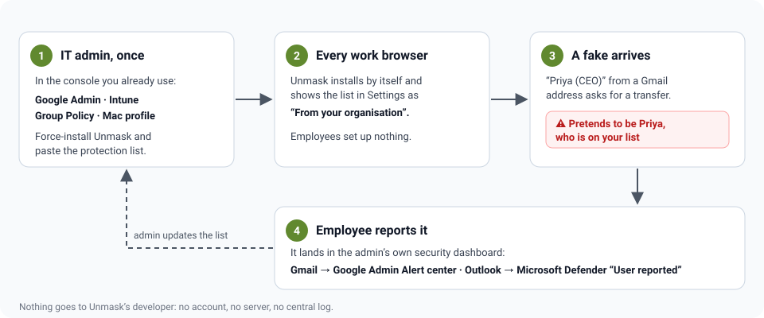
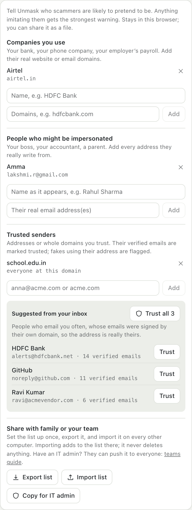
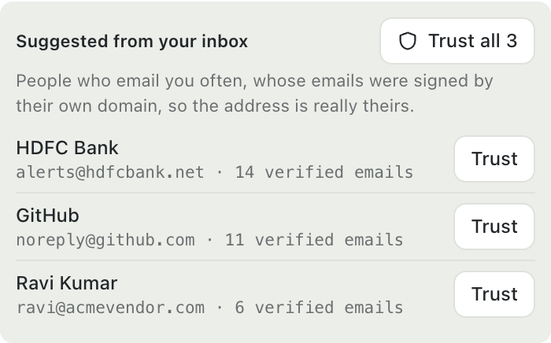
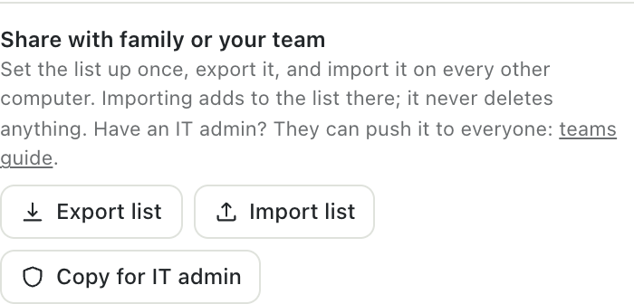
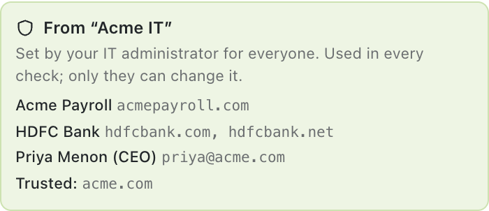
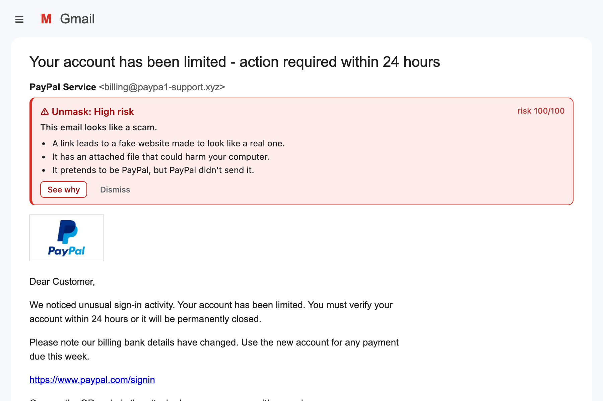
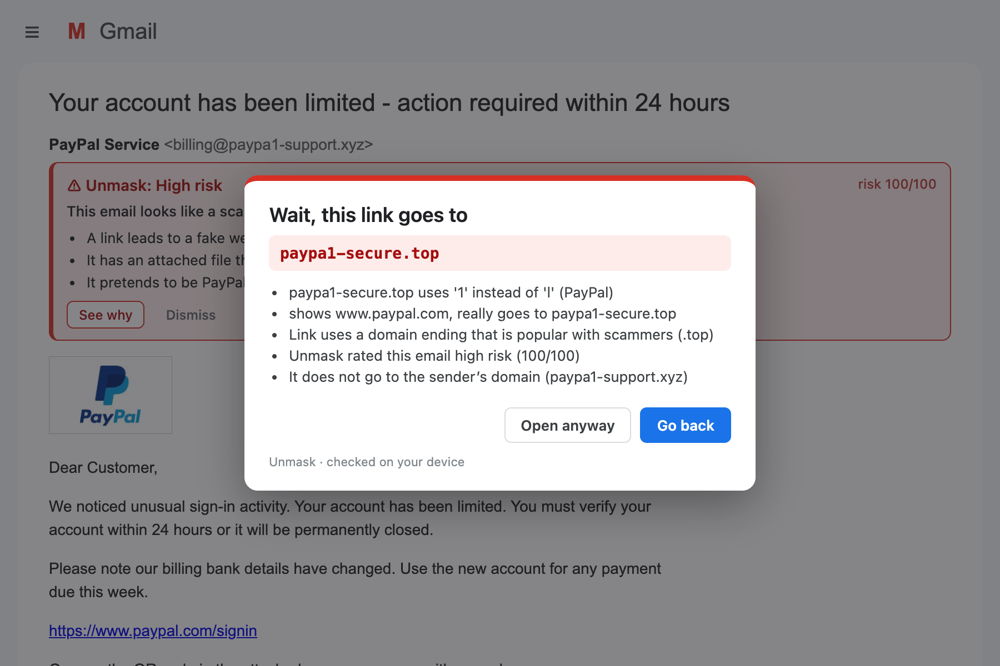

# Unmask for teams, schools and families

Unmask is free for organisations too. There is no paid tier, no account and no sign-up. Everything below uses tools you already have.



**Pick your path:**

| You are | Time | Go to |
|---|---|---|
| A family, or a small team with no IT admin | 10 minutes | [Path A: share a file](#path-a-share-the-list-as-a-file) |
| An IT admin (Google Workspace, Microsoft 365, Windows domain, Macs) | 30 minutes | [Path B: install it for everyone](#path-b-install-it-for-everyone) |

## Where is the dashboard?

**Unmask has no dashboard of its own, on purpose.** It never collects anything, so there is nothing to show on a website of ours. Everything a team needs lives in places you already have:

| You want to… | Where |
|---|---|
| Install Unmask on every computer, and set the list | **Google Admin:** [admin.google.com](https://admin.google.com) → Devices → Chrome → Apps & extensions<br>**Microsoft Intune:** [intune.microsoft.com](https://intune.microsoft.com) → Devices → Configuration<br>**Windows domain:** Group Policy Management Editor<br>**Macs:** your MDM (Jamf, Kandji, Mosyle…) |
| See which computers have it | **Google Admin:** Devices → Chrome → Reports → *Apps & extensions usage*<br>**Microsoft:** the Edge or Chrome policy report in Intune |
| See the emails people reported | **Google Workspace:** Admin console → Security → *Alert center* ("User reported phishing")<br>**Microsoft 365:** [security.microsoft.com](https://security.microsoft.com) → Submissions → *User reported* |
| Change the list for everyone | Same place you set it. Browsers pick up the change by themselves. |
| See what a single person sees | On their computer: Unmask → **Settings** → *Your protection list* |

## Path A: share the list as a file

For families and small teams. One person sets up the list, everyone else imports it.

### Step 1. Fill in the protection list

Open Unmask, click the **gear** (Settings), and scroll to **Your protection list**:

- **Companies you use:** the name and real domain of your bank, phone company, payroll provider. *Example:* HDFC Bank → `hdfcbank.com, hdfcbank.net`.
- **People who might be impersonated:** your boss, accountant or a parent, with every address they really use.
- **Trusted senders:** addresses or whole domains you trust.



### Step 2. Trust the people you hear from, in one click

Under **Trusted senders**, Unmask suggests people who email you often and whose emails were signed by their own domain, so the address is really theirs. Click **Trust** on each, or **Trust all**.



Senders that weren't signed, or that you've only heard from once or twice, are never suggested.

### Step 3. Export the list

Click **Export list**. Unmask saves `unmask-protection.json` to your Downloads folder.



### Step 4. Import it on every other computer

Send the file to your family or team (WhatsApp, email, a shared drive). On each computer: Unmask → **Settings** → **Import list** → pick the file.

Importing only **adds** entries. It never deletes anything that person already had.

### Step 5. Keep it up to date

When something changes (a new bank, a new manager), update the list on your computer, export again, and send the new file. Importing it again adds the new entries.

## Path B: install it for everyone

For IT admins. Unmask installs by itself on every work browser, and the list appears for everyone without them doing anything.

**Extension IDs you'll need**
- Chrome and Edge (from the Chrome Web Store): `bcogajaabcenbcbfbcgfjmccjdlfklcc`
- Firefox: `unmask@praneeth132006.github.io`

### Step 1. Build the list

The easiest way: install Unmask on your own computer, fill in the protection list as in [Path A, steps 1 and 2](#step-1-fill-in-the-protection-list), then click **Copy for IT admin**. That copies the list in the exact format Google Admin expects.

To write it by hand instead, it looks like this:

```json
{
  "label": "Acme IT",
  "brands": [
    { "name": "Acme Payroll", "domains": ["acmepayroll.com"] },
    { "name": "HDFC Bank", "domains": ["hdfcbank.com", "hdfcbank.net"] }
  ],
  "contacts": [
    { "name": "Priya Menon (CEO)", "addresses": ["priya@acme.com"] }
  ],
  "trusted": ["acme.com"]
}
```

- `label` is shown to employees as "From “Acme IT”".
- **brands:** companies whose real domains you know. Anything else claiming to be them gets a red warning.
- **contacts:** people scammers impersonate, with every address they really use. The CEO, finance, HR.
- **trusted:** your own domain and close vendors.

Invalid entries (a company with no domain, a malformed address) are skipped.

### Step 2. Install it and push the list

Do the part for your console.

<details open>
<summary><b>Google Admin console</b> (Google Workspace, Chrome Enterprise)</summary>

1. Sign in at [admin.google.com](https://admin.google.com).
2. Go to **Devices → Chrome → Apps & extensions → Users & browsers**.
3. On the left, pick the organisational unit (for example, the whole company).
4. Click the yellow **+** at the bottom right → **Add Chrome app or extension by ID**, paste `bcogajaabcenbcbfbcgfjmccjdlfklcc`, and choose **From the Chrome Web Store**.
5. Set **Installation policy** to **Force install + pin to browser toolbar**.
6. In **Policy for extensions** on the right, paste what **Copy for IT admin** gave you. It looks like this:

   ```json
   { "protectionList": { "Value": { "label": "Acme IT", "brands": [], "contacts": [], "trusted": ["acme.com"] } } }
   ```

7. Click **Save**. Browsers pick it up within a few hours, or straight away after a restart.

</details>

<details>
<summary><b>Windows: Group Policy</b> (Chrome or Edge)</summary>

1. Install the Chrome or Edge administrative templates if you haven't already.
2. In the Group Policy Management Editor, open **Extensions → Configure the list of force-installed apps and extensions** and add:

   ```
   bcogajaabcenbcbfbcgfjmccjdlfklcc;https://clients2.google.com/service/update2/crx
   ```

3. Push the list as a registry value. Type `REG_SZ`, name `protectionList`, data: the list JSON from step 1 on **one line**.
   - Chrome: `HKLM\Software\Policies\Google\Chrome\3rdparty\extensions\bcogajaabcenbcbfbcgfjmccjdlfklcc\policy`
   - Edge: `HKLM\Software\Policies\Microsoft\Edge\3rdparty\extensions\bcogajaabcenbcbfbcgfjmccjdlfklcc\policy`

   Group Policy Preferences → **Registry** is the easiest way to push it to every computer.

</details>

<details>
<summary><b>Microsoft Intune</b> (Edge or Chrome)</summary>

1. At [intune.microsoft.com](https://intune.microsoft.com), go to **Devices → Configuration → Create → New policy**, platform **Windows 10 and later**, profile **Settings catalog**.
2. Add **Microsoft Edge → Extensions → Control which extensions are installed silently** (or the Chrome equivalent), with `bcogajaabcenbcbfbcgfjmccjdlfklcc;https://clients2.google.com/service/update2/crx`.
3. Push the list as the same registry value as in the Group Policy section, using a PowerShell script or a custom OMA-URI.
4. Assign the policy to your users or devices.

</details>

<details>
<summary><b>Macs</b> (configuration profile from your MDM)</summary>

1. Force-install with the Chrome policy `ExtensionInstallForcelist` (same value as Windows).
2. Add a custom payload with the domain `com.google.Chrome.extensions.bcogajaabcenbcbfbcgfjmccjdlfklcc` and a key `protectionList` holding the list as a **dictionary** (not a string).

</details>

<details>
<summary><b>Firefox</b> (policies.json)</summary>

Put this in Firefox's `policies.json` (or the matching Group Policy):

```json
{
  "policies": {
    "ExtensionSettings": {
      "unmask@praneeth132006.github.io": {
        "installation_mode": "force_installed",
        "install_url": "https://addons.mozilla.org/firefox/downloads/latest/unmask-phishing-inspector/latest.xpi"
      }
    },
    "3rdparty": {
      "Extensions": {
        "unmask@praneeth132006.github.io": {
          "protectionList": { "label": "Acme IT", "brands": [], "contacts": [], "trusted": ["acme.com"] }
        }
      }
    }
  }
}
```

</details>

### Step 3. Check that it worked

On any work computer:

1. Open `chrome://policy` (or `edge://policy`) and click **Reload policies**. Unmask's ID appears with a `protectionList` policy.
2. Open Unmask → **Settings**. The list starts with **From “Acme IT”** and your entries:



Employees can't change or remove these entries. They can still add their own below them.

### Step 4. What employees see

Nothing to learn. When an email imitates anyone on the list, a warning appears inside Gmail or Outlook:



When they click a risky link, Unmask stops it first:



**Tip for your announcement email:** "We've installed Unmask. If you see a red warning, don't click, don't reply. Use Report phishing."

### Step 5. Reports come to you

- **Gmail:** employees click **Report phishing in Gmail** in Unmask (it opens Gmail's own report). In Google Workspace, reports show up in **Admin console → Security → Alert center** as "User reported phishing".
- **Outlook:** employees use Outlook's own **Report** button. Reports show up at [security.microsoft.com](https://security.microsoft.com) → **Submissions → User reported**.

Unmask is not in the middle: reports go from your mail system to your admin console.

### Step 6. Update the list

Edit the policy in the same place and save. Browsers pick up the change by themselves, usually within a few hours.

## Online checks at work

Every check that runs on the computer needs no key and no account: sender, links, look-alike domains, attachments, QR codes, tracking pixels, the protection list. That's most of Unmask, and it's free for any use, including in companies.

The optional buttons for outside services follow those services' own rules:

- **VirusTotal's free API is for personal use only.** In a business it needs a VirusTotal Premium licence. Without one, leave the VirusTotal key empty on work computers. Unmask works fine without it.
- **urlscan.io, Hybrid Analysis and abuse.ch** each have their own terms for organisations. Check them before rolling keys out.

See [Limits & costs](LIMITS_AND_COSTS.md) for each service.

## Questions

**Does Unmask send us, or anyone, our employees' emails?** No. Emails are analysed on each computer. The admin pushes the list *to* browsers; nothing comes back. See the [privacy policy](../PRIVACY.md).

**Does it cost anything for a company?** No. Unmask is free and MIT-licensed for everyone.

**Can employees turn it off?** If you force-install it, they can't remove it. They can change their own settings in Unmask.

**Does it work in Outlook?** Yes, in Outlook on the web (outlook.office.com and outlook.live.com). Not in the Outlook desktop app.

**Something's wrong, or a real email got a warning?** [Open an issue](https://github.com/praneeth132006/Unmask/issues/new/choose). There's a template for wrong verdicts.
