# Unmask user guide

This guide is for everyone, no technical background needed. It covers installing Unmask, reading its report, setting up the optional checks, and fixing common problems.

- [1. Install](#1-install)
- [2. Your first check](#2-your-first-check)
- [3. Reading the report](#3-reading-the-report)
- [4. Hover to see it in the email](#4-hover-to-see-it-in-the-email)
- [5. Setting up VirusTotal](#5-setting-up-virustotal)
- [6. Setting up urlscan.io](#6-setting-up-urlscanio)
- [7. Tracing redirects](#7-tracing-redirects)
- [8. Emails from Outlook and other apps](#8-emails-from-outlook-and-other-apps)
- [8a. Warnings inside your inbox](#8a-warnings-inside-your-inbox)
- [8b. Reporting an email](#8b-reporting-an-email)
- [8c. Peek: check an email without opening it](#8c-peek-check-an-email-without-opening-it)
- [8f. Finding the tracking pixels](#8f-finding-the-tracking-pixels)
- [8d. Plain words and simple mode](#8d-plain-words-and-simple-mode)
- [8e. Your protection list (and sharing it with family or a team)](#8e-your-protection-list-and-sharing-it-with-family-or-a-team)
- [9. Settings](#9-settings)
- [10. Troubleshooting](#10-troubleshooting)
- [11. FAQ](#11-faq)

---

## 1. Install

**Easiest (Chrome, Edge, Brave):** open [Unmask on the Chrome Web Store](https://chromewebstore.google.com/detail/unmask-%E2%80%94-phishing-email-i/bcogajaabcenbcbfbcgfjmccjdlfklcc) and click **Add to Chrome**. While the extension is new, Chrome may show *"not trusted by Enhanced Safe Browsing"*; click **Continue to install**.

For Firefox, or if you'd rather not use the store, install it as a "developer" extension. You only do this once. Pick **Option 1** unless you want to build Unmask yourself.

### 1a. Option 1: No-code install (recommended)

No programming tools needed.

1. Open the **[latest Unmask release](https://github.com/praneeth132006/Unmask/releases/latest)**.
2. Scroll to **Assets** and click the file named **`unmask-chrome-<version>.zip`**, for example `unmask-chrome-0.2.1.zip`.
   *Don't download "Source code (zip)": that's the code for developers, not the extension.*
3. Unzip it:
   - **Mac:** double-click the zip in Downloads. (Safari may already have unzipped it for you.)
   - **Windows:** right-click the zip → **Extract All…** → **Extract**.
   You now have a folder named **`unmask-chrome-<version>`**.
4. Move that folder somewhere permanent, for example **Documents → Unmask**. Chrome loads Unmask from this folder every time it starts, so don't delete or rename it.
5. **Check you have the right folder:** open it. You should see `manifest.json`, `sidepanel.html` and folders named `icon`, `chunks` and `content-scripts`. If you see another folder with the same name instead, go one level deeper: that inner folder is the one to load.

Now [load it into Chrome](#1c-load-it-into-chrome).

### 1b. Option 2: Build from source

You need [Node.js](https://nodejs.org) (version 20 or newer) and [pnpm](https://pnpm.io/installation). In a terminal:

```bash
git clone https://github.com/praneeth132006/Unmask.git
cd Unmask
pnpm install
pnpm build
```

This creates the folder **`build/unmask-chrome`**. That folder *is* the extension.

### 1c. Load it into Chrome

1. In Chrome's address bar, type `chrome://extensions` and press Enter.
   *(This is Chrome's own settings page, not the Chrome Web Store.)*
2. Turn on **Developer mode** with the switch in the **top-right corner**.
3. Three buttons appear on the left. Click **Load unpacked**.
4. Select the extension folder and click **Select**:
   - Option 1: the unzipped **`unmask-chrome-<version>`** folder (the one that contains `manifest.json`).
   - Option 2: open the project folder, open **`build`**, and click **`unmask-chrome`** once.
5. Unmask appears in your list of extensions.
6. Click the **puzzle-piece icon** in Chrome's toolbar and click the **pin** next to Unmask so its icon is always visible.

> Edge and Brave work the same way: use `edge://extensions` or `brave://extensions`.

### 1d. Reload Gmail

If Gmail was already open, **reload the Gmail tab** (press ⌘R or Ctrl+R). Unmask can only connect to Gmail pages opened after it was installed.

### If loading fails

| Chrome says | What it means | Fix |
|---|---|---|
| *Manifest file is missing or unreadable* | You selected the wrong folder (often the parent folder, or Downloads) | Select the folder that directly contains `manifest.json` |
| You can't select the `.zip` file | Chrome loads folders, not zip files | Unzip it first (step 3) |
| *Load unpacked* button is missing | Developer mode is off | Turn on the **Developer mode** switch, top right |
| Unmask disappeared after a restart | The folder was moved or deleted | Put the folder back, or load it again from its new place |
| *This extension is not from any known source* or *Disable developer mode extensions* pop-up | Chrome's normal warning for extensions not installed from the Web Store | Click **Cancel** / keep it enabled. It's expected for developer installs |

### Updating

- **Option 1:** download the newer `unmask-chrome-<version>.zip` from the [latest release](https://github.com/praneeth132006/Unmask/releases/latest) and unzip it. **Copy the new files into your existing Unmask folder**, replacing the old ones, then click the **↻ reload** button on the Unmask card in `chrome://extensions`.
  *Why the same folder?* Chrome identifies a developer-installed extension by its folder. Loading a new folder installs a second copy that starts with empty settings, so you'd have to set up your API keys again.
- **Option 2:** after pulling new code and running `pnpm build` again, click the **↻ reload** button on the Unmask card.

Then reload Gmail.

---

## 2. Your first check

1. Open Gmail and open any email.
2. Click the **Unmask icon** in the toolbar. A side panel opens on the right.
3. Unmask reads the email and shows its report within a second or two.

When you open a different email, the panel follows automatically. In a conversation with several messages, a menu at the top lets you pick which message to inspect.

You don't have to open the panel to be protected: risky emails also get a warning banner inside Gmail (see [Warnings inside your inbox](#8a-warnings-inside-your-inbox)).

---

## 3. Reading the report

### The summary

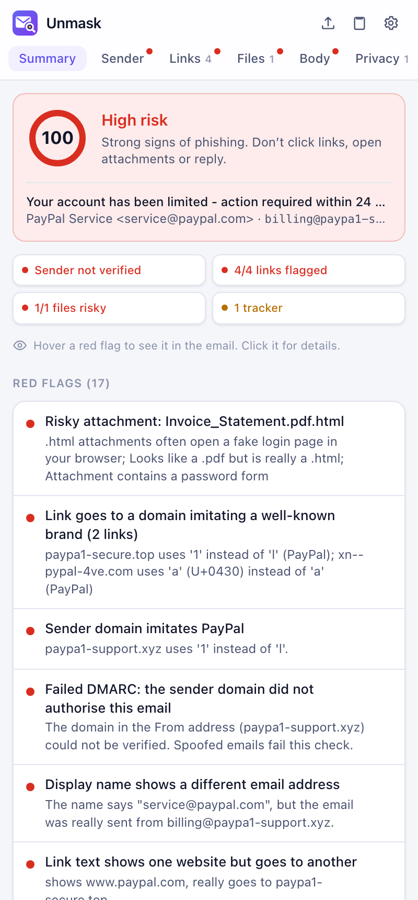

At the top is the **verdict**:

| Verdict | Score | What to do |
|---|---|---|
| 🔴 **High risk** | 50 to 100 | Strong signs of phishing. Don't click links, open attachments or reply. |
| 🟠 **Suspicious** | 20 to 49 | Some warning signs. Check with the sender another way, for example by calling them, before acting. |
| 🟢 **No red flags found** | 0 to 19 | Nothing obviously wrong. That's not a guarantee, so stay careful. |

Below it, four **summary chips** give the state of the sender, links, files and trackers at a glance. Click a chip to open that section. When a genuine signature is being misused (a replayed email or a fake "passed" stamp), the sender chip says **Signature passes, but misused** instead of *Sender verified*.

**What this looks like** names the kind of attack the red flags point to, such as *Password phishing*, *Callback scam* or *Replayed genuine email*, each with a confidence. Open **What Unmask couldn't check** to see this email's blind spots, such as links checked by address only or a signature not verified with the sender's key.

<p>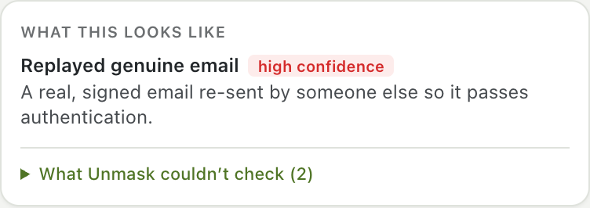</p>

Then come the findings:

- **Red flags**: problems, worst first. Each one says what's wrong in plain words.
- **Good signs**: things that check out, such as a verified sender.
- **Notes**: neutral information, such as how old the sender's domain is.

> Unmask never says an email is "safe". A clean result means the checks found nothing, not that nothing is there.

<br clear="right">

### The tabs

The row under the Unmask logo stays visible while you scroll. A **red dot** on a tab means it contains a warning. Every tab has a **Back to summary** button that returns you to where you were.

| Tab | What it shows |
|---|---|
| **Summary** | Verdict, summary chips and all findings |
| **Sender** | Who really sent the email: the real address, where replies go, how old the domain is, and SPF/DKIM/DMARC results explained in plain language |
| **Links** | Each link: the text you see, where it **really** goes (with the real website in bold), warnings, and buttons for extra checks |
| **Files** | Each attachment: type, size, fingerprint (SHA-256), warnings, and a VirusTotal check |
| **Body** | The email shown safely: scripts off, links disabled, images blocked. Switch on **Show hidden text** to see invisible text outlined in red |
| **Privacy** | Tracking pixels and click-tracked links, which company runs them, **where each pixel sits in the email**, and how to avoid tracking |
| **Headers** | Every DKIM signature (did the text change after signing? does the signature verify with the sender's key?), the forwarding record (ARC), the delivery path from the first server to your inbox (steps written before your provider got the email are marked *can't be verified*, and the sending server's network when that check is on), and every technical header, with a filter box |

<p>
  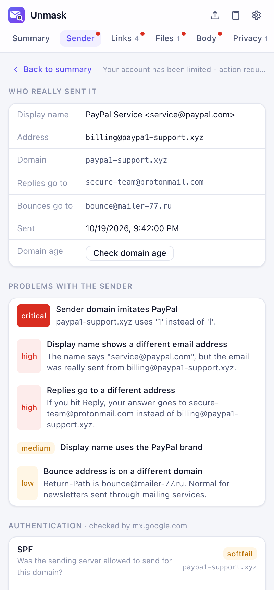
  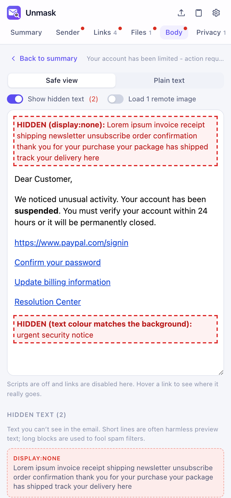
  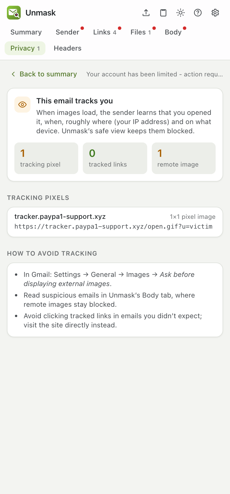
</p>

### What the most common red flags mean

| Red flag | In plain words |
|---|---|
| *Display name shows a different email address* | The name says one address but the email came from another. A classic trick. |
| *Sender domain imitates PayPal* (or another brand) | The address looks like the real company's but has swapped letters, such as `paypa1` or a Cyrillic `а`. |
| *Failed DMARC* | The domain in the From address did not authorize this email. Spoofed emails fail this. |
| *Replies go to a different address* | If you hit Reply, your answer goes to someone else, often a free webmail account. |
| *Link text shows one website but goes to another* | The link *looks* like `paypal.com` but takes you somewhere else. |
| *Risky attachment* | A file type that can run code or open a fake login page, or a file pretending to be a PDF. |
| *Hidden text blocks* | Invisible text, often stuffed in to fool spam filters. |
| *Sender domain was registered N days ago* | Real companies use domains that are years old. New ones are a strong warning sign. |

The full list, with points, is in [CHECKS.md](CHECKS.md). How each step works, from the delivery path to the analyst write-up, is in [How Unmask analyses an email](ANALYSIS.md).

---

## 4. Hover to see it in the email

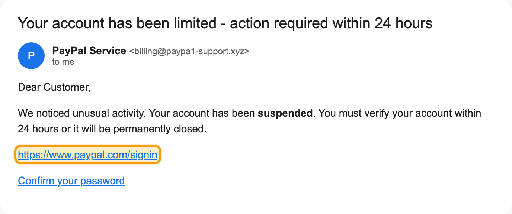

**Hover over any red flag** in the Summary, and Unmask outlines the matching part of the email in Gmail, scrolling it into view if needed:

- link warnings outline the **links**,
- sender warnings outline the **sender's name**,
- attachment warnings outline the **attachment**,
- pressure-language warnings **mark the exact words**, such as "verify your account" or "within 24 hours".

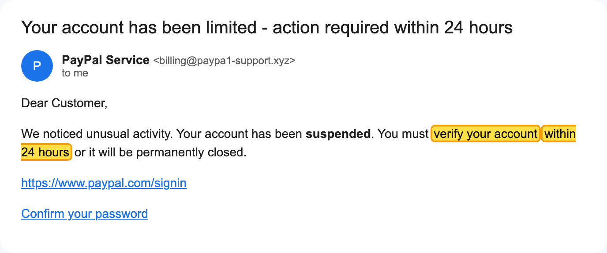

Hovering a link card in the Links tab, an attachment in the Files tab, or the sender box in the Sender tab works the same way.

**Click** a red flag to jump to its details, for example the exact link card. Use **Back to summary** to return to the same spot.

> The outline only appears for emails opened in Gmail. It isn't available for `.eml` files, since there's no Gmail page to point at.

---

## 5. Setting up VirusTotal

VirusTotal checks files and links against 70+ antivirus engines. It's free. Unmask only sends a file's **fingerprint** (a SHA-256 hash), never the file itself, unless you choose to upload it.

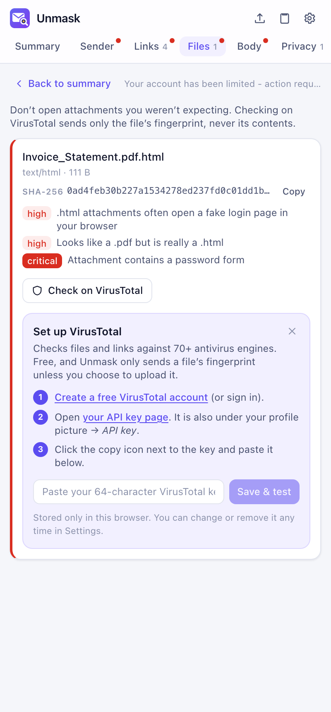

**The easy way:** click **Check on VirusTotal** on any attachment, or **VirusTotal** on any link. If no key is set up yet, the panel shows these steps right there:

1. Click **Create a free VirusTotal account** (or sign in if you have one).
2. Click **your API key page**. You can also find it by clicking your profile picture on virustotal.com, then **API key**.
3. Click the **copy icon** next to your key. It's a long string of 64 letters and numbers.
4. Paste it into the box in Unmask and click **Save & test**.

Unmask checks the key works before saving it. You'll see **"Connected to VirusTotal"**, and the check you clicked runs automatically.

> **What is an "API key"?** A password that lets an app use your VirusTotal account. It's not your account password. Unmask stores it only in your browser.

**Limits and cost:** free keys allow 4 lookups per minute and 500 per day, and **can never be charged**: going over just pauses lookups until the limit resets. The free API is for personal use; using Unmask for your company's security work needs a VirusTotal Premium licence. See [Free limits and costs](LIMITS_AND_COSTS.md).

**Scanning a new link:** if VirusTotal has never seen a link, Unmask offers **Scan it now**. Submitted links become visible to VirusTotal's customers, including any name, address or token inside them, so Unmask asks you to confirm first. For personal links use the private **Sandbox scan** instead.

**Uploading files:** if VirusTotal has never seen a file, Unmask offers **Upload file…**. Uploaded files can be downloaded by VirusTotal's paying customers, so **never upload anything confidential** such as invoices, contracts, payslips or ID documents. Unmask asks you to confirm first.

<br clear="right">

---

## 6. Setting up urlscan.io

urlscan.io opens a link in **its own** sandbox browser, never yours, and shows you a screenshot of where it lands, the final address, and whether it's known to be malicious. Free.

Click **Sandbox scan** on any link and follow the steps in the panel:

1. Click **Create a free urlscan.io account** (or sign in).
2. Click **Settings & API**, then **New API key**.
3. Copy the key, which looks like `1a2b3c4d-…` (36 characters with dashes).
4. Paste it into Unmask and click **Save & test**.

**Free limits:** 50 private scans per day, at no cost. Going over just pauses scans until the next day. See [Free limits and costs](LIMITS_AND_COSTS.md).

A scan takes 10 to 30 seconds. **Every scan is private**: only your urlscan.io key can see its result and screenshot; it never appears in urlscan's public feed or search, or in urlscan Pro for its security partners. The screenshot is fetched with your key and shown in the Links tab, with **Save screenshot** to keep a copy, and where the link lands is added to the report and exports.

---

## 7. Tracing redirects

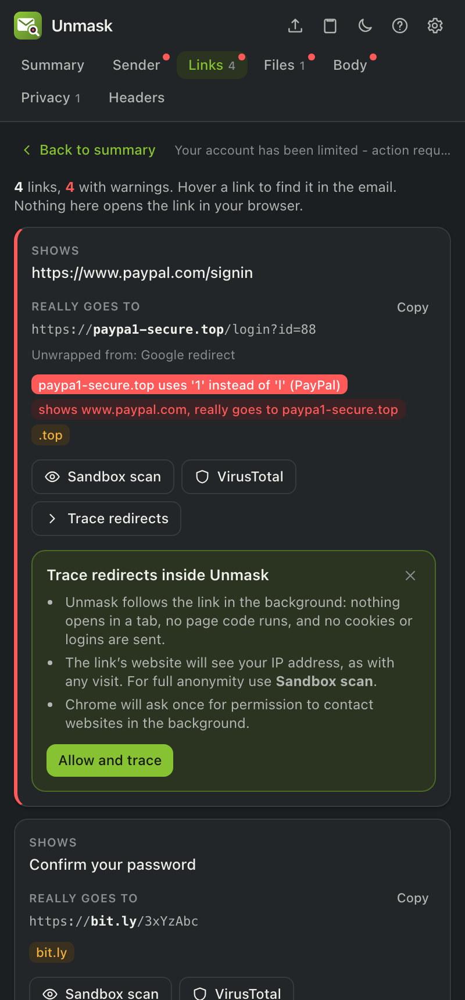

Links in emails often bounce through several addresses (`bit.ly → tracker → final page`). **Trace redirects** shows every step and where the link really ends, without opening it.

1. In the **Links** tab, click **Trace redirects** on any link.
2. The first time, Unmask explains what will happen. Click **Allow and trace**, then **Allow** in Chrome's prompt. You only do this once.
3. The redirect chain appears in the card: each address, its status code, and how it redirected (HTTP, a `<meta refresh>` or JavaScript).

**What happens behind the scenes:** Unmask's background worker requests the link **without cookies or logins**, never opens it in a tab, and never runs its code. It reads only the first part of each page to spot meta or JavaScript redirects. Links pointing at your own network (your router, `localhost`, `192.168.x.x`) are refused.

**Privacy note:** the link's website sees your IP address, just as if you'd visited it. If you'd rather it didn't, use **Sandbox scan** (urlscan.io visits it for you), or set up your own trace server under **Settings → Advanced → Redirect tracing → My own server** (see [BACKEND.md](BACKEND.md)).

**Why does Chrome ask for permission?** Tracing needs to contact any website the link might lead to. The permission is optional and requested only when you first use it, so installing Unmask doesn't ask for it. You can remove it any time from `chrome://extensions` → Unmask → **Details** → **Site access**.

<br clear="right">

---

## 8. Emails from Outlook and other apps

**Outlook on the web** (outlook.live.com, outlook.office.com) works like Gmail: open an email and click the Unmask icon. Outlook doesn't let pages read an email's original source, so Unmask reads what Outlook shows. Links, text, QR codes, logos and sender checks all work; for the header checks (SPF, DKIM, DMARC, delivery path) paste the source as described below.

Unmask can also analyze any saved email:

- **Drop a file:** save the email as an `.eml` file and drag it onto the Unmask panel, or click the **upload icon** at the top.
  - *Gmail:* open the email → ⋮ → **Download message**
  - *Outlook on the web:* open the email → … → **Save as** (or **Download**)
  - *Apple Mail:* File → **Save As…** → format **Raw Message Source**
  - *Thunderbird:* File → **Save As** → **File**
- **Paste the source:** click the **clipboard icon** and paste the raw email.
  - *Gmail:* ⋮ → **Show original** → **Copy to clipboard**
  - *Outlook:* … → **View** → **View message source**

To open Unmask's panel outside Gmail, click its toolbar icon on any page. In **Firefox** the panel opens in the sidebar.

---

## 8a. Warnings inside your inbox

Unmask checks each email as you open it, even when its panel is closed:

- **Banner:** a red (high risk) or amber (suspicious) banner above the email lists the main reasons. **See why** opens the full report; **Dismiss** hides it for that email.
- **Inbox badges:** risky senders get a small **⚠ Risky** or **Check** badge in the email list. Hover it for the reasons.
- **Before a risky link opens** you'll see *"Wait, this link goes to paypa1-secure.top"*. **Go back** is the safe choice; **Open anyway** opens it in a new tab.
- **Before replying** to an email whose replies are set to go to a different address, Unmask shows where your answer would really go.
- **First contact:** Unmask remembers, only on your device, who normally emails you. It tells you when a sender has never emailed you before, or when "PayPal" writes from a domain your PayPal emails never came from. It starts doing this after it has seen 10 senders.

All of these are on by default; each can be switched off in **Settings → Protection inside Gmail**.

---

## 8b. Reporting an email

At the bottom of the Summary, **Report or export** offers:

- **Report phishing in Gmail:** opens Gmail's own *Report phishing*; confirm it in Gmail's dialog. This trains Gmail's filters.
- **Send to APWG** or **Netcraft:** downloads the email as an `.eml` file and opens a pre-filled email to their reporting address. Attach the downloaded file and send.
- **Report the riskiest link** to Google Safe Browsing (address filled in), PhishTank or Netcraft (address copied; paste it in).
- **PDF report**, **JSON** and **Original (.eml)** for your IT or security team.
- **Copy analyst write-up**: a plain-text case report in the order a security analyst works (verdict and attack type, message identifiers, authentication and DKIM signatures, delivery path, findings, indicators, what wasn't checked, recommended actions), ready to paste into a ticket.
- **Copy indicators**: the sender, Reply-To, bounce address, origin IP, delivering server, signing domains, suspicious URLs and domains, file hashes and callback phone numbers, one per line and defanged (`hxxps://paypa1[.]top`, `billing[@]evil[.]xyz`) so nothing becomes a clickable link.

Unmask never sends a report itself; you always review and send it.

---

## 8c. Peek: check an email without opening it

**Why:** when you open an email, Gmail shows its pictures. Marketing and scam emails hide tiny invisible pictures ("tracking pixels") among them. Loading one tells the sender *that* you opened it and *when*, which confirms your address is real. Gmail fetches pictures through its own proxy, so the sender doesn't get your IP address, but it still learns you opened the email.

**What Peek does:** every row in your inbox list gets a small **👁 Peek** button at the start of the subject, where Gmail shows its own labels. Risky senders also get a **⚠ Risky** or **Check** badge there.

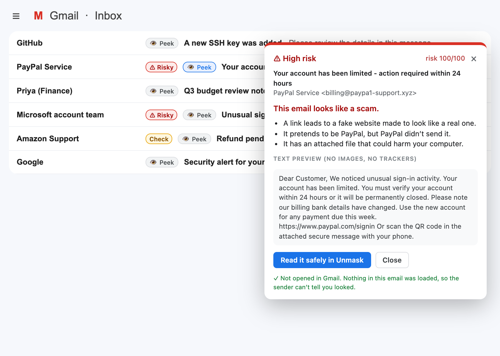

1. Click **Peek** on any email in the list. The email does **not** open.
2. Unmask downloads that email's original source from Gmail (the same file Gmail's *Download message* gives you) and checks it on your computer.
3. A card shows the verdict, the reasons in plain words, a **Trackers** section and a **text-only preview** of the email's words.
   - **Trackers** says exactly what the email contains, for example *"Contains 1 tracking pixel among 4 remote images. Peek loaded none of them"* and *"24 links are click-tracked"*. The email still has these trackers; Peek just didn't load them, so none fired. If you then open the email in Gmail, its images load and the pixels do fire.
   - The preview shows no pictures and loads nothing from the internet.
4. Choose:
   - **Read it safely in Unmask**: the side panel opens with the full report. The **Body** tab shows the email with pictures blocked and links disabled. It's still not opened in Gmail.
   - **Close** and delete or report the email from the list without ever opening it.
   - If it's fine, open it in Gmail as usual.

The row's badge updates with the full result, so you won't need to Peek again.

**New emails are checked automatically.** With **Settings → Protection inside Gmail → Check new emails before I open them** (on by default), Unmask Peeks at up to 15 unread emails in the list you're looking at, one at a time, and badges the risky ones before you open anything. Turn it off if you'd rather only check emails when you click Peek.

**No Peek buttons?**
1. Make sure you have version 0.3.0 or later: the version is at the bottom of Settings.
2. After updating, click **↻ reload** on Unmask in `chrome://extensions`, then **reload the Gmail tab**. Gmail tabs opened before the update keep running the old version.
3. Open the Unmask panel on your inbox. It says how many emails in the list have a Peek button, or that Peek is switched off.

**Good to know**
- In a conversation with several messages, Peek checks the first message.
- Peek works in Gmail. Outlook on the web doesn't let pages download a message's source, so there you get the inbox badges only.
- Unmask's tests use a stand-in for Gmail, so we can't promise how Gmail treats the download. If Gmail marks the email as read, that only changes the bold styling in your own inbox; it isn't sent to the sender.

---

## 8f. Finding the tracking pixels

A tracking pixel is a tiny image, usually 1×1 and invisible, that the sender's mailing service hosts. When your mail app downloads it, the service learns that you opened the email and when. Unmask shows exactly where each one is.

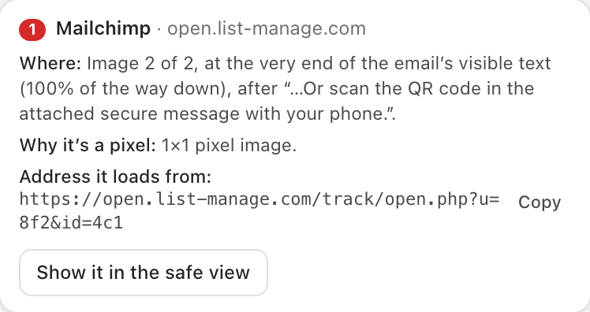

**Privacy tab → Where the tracking pixels are.** Each pixel gets a number and:
- **which service** runs it (Mailchimp, SendGrid…) and the host it loads from;
- **Where:** for example *"Image 2 of 2, at the very end of the email's visible text (100% of the way down), after '…with your phone.'"*. The position is measured on the text you'd actually see; hidden text isn't counted. If the pixel sits inside a hidden block, it says so: you'd never see it, but it still loads with the email's images;
- **Why it's a pixel:** for example *1×1 pixel image*, *hidden image* or *image at a tracking address*;
- **the full address it loads from**, with a Copy button.

**See it in the email:**
- **Show it in the safe view** opens the Body tab with a red **"● Tracking pixel 1 (Mailchimp): blocked"** tag exactly where the invisible pixel is, highlighted, plus a note repeating where it is. Scroll the preview to that tag.
- With the email open in Gmail, **hover** a pixel in the Privacy tab and Unmask puts a red **"● Tracking pixel 1 is here"** label at that spot in Gmail. This only works when Gmail is showing the email's images; with "Ask before displaying external images" on, Gmail hasn't added the image, so there's nothing to label.

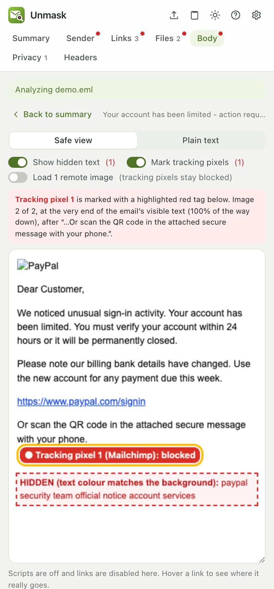

**Tracking pixels never load in Unmask.** The safe view and Peek never load them, even if you switch on **Load remote images** in the Body tab (it says "tracking pixels stay blocked"). Other images do load then, straight from the sender's servers, which shows them your IP address. Unmask warns you when you switch it on.

---

## 8d. Plain words and simple mode

Every report starts with an **In plain words** card: one sentence ("This email looks like a scam."), up to three reasons in everyday language ("It pretends to be PayPal, but PayPal didn't send it.") and **What to do**. The warning banner inside Gmail uses the same sentence.

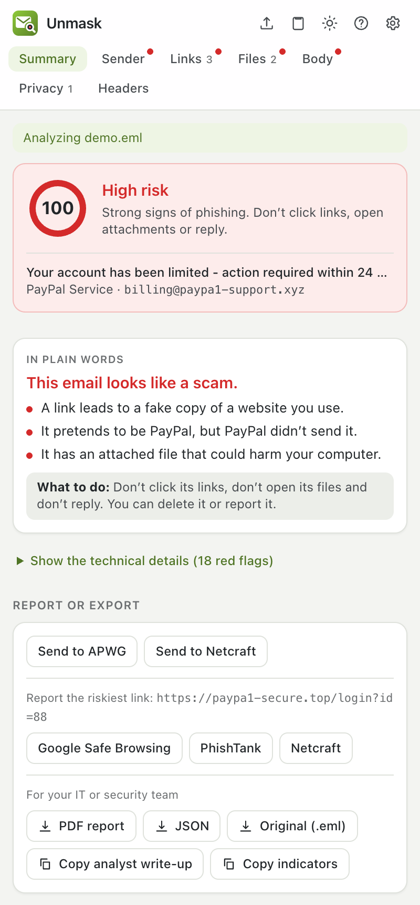

For parents or colleagues who don't want the technical side, turn on **Settings → Appearance → Simple mode**. The Summary then shows the plain-words card and the report buttons first, with the red flags folded under **Show the technical details**. The tabs (Sender, Links, Files, Body, Privacy, Headers) stay at the top as usual.

<br clear="right">

---

## 8e. Your protection list (and sharing it with family or a team)

Scammers usually pretend to be *your* bank, *your* boss or *your* family. Tell Unmask who those are and anything imitating them gets the strongest warning (Critical).

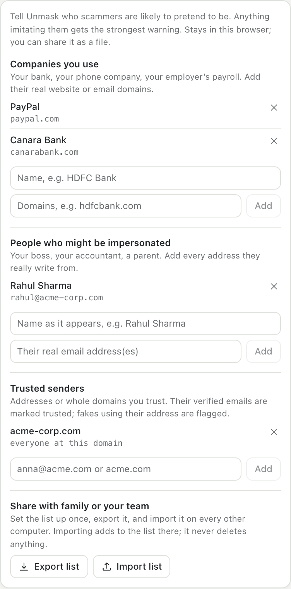

Open **Settings → Your protection list**:

- **Companies you use:** a name and its real domains, for example *Canara Bank* → `canarabank.com`. Unmask then flags emails that name it in the sender or subject but come from elsewhere, sender domains imitating it (`canarabnak.com`), and links to look-alikes (`canarabank-kyc.top`).
- **People who might be impersonated:** a name and every real address they use, for example *Rahul Sharma* → `rahul@acme-corp.com`. An email calling itself "Rahul Sharma" from any other address gets a red warning. This is the classic "boss asks for gift cards" scam.
- **Trusted senders:** addresses (`mom@gmail.com`) or whole domains (`acme-corp.com`). Verified emails from them are marked trusted and never get a "first contact" warning. An email that *uses* a trusted address but fails verification is flagged as a fake.

**Quicker:** on any genuine email, open the **Sender** tab and click **Trust this sender** or **Protect "name"**.

**Set it up once for everyone:**
1. On your computer, fill in the list, then click **Export list**. You get `unmask-protection.json`.
2. Send the file to family members or teammates (email, WhatsApp, a shared drive).
3. On their computer: **Settings → Your protection list → Import list** and pick the file.

Importing only adds to their list; it never deletes what they already have. The file contains only names, domains and addresses you typed, nothing from anyone's emails.

<br clear="right">

---

## 9. Settings

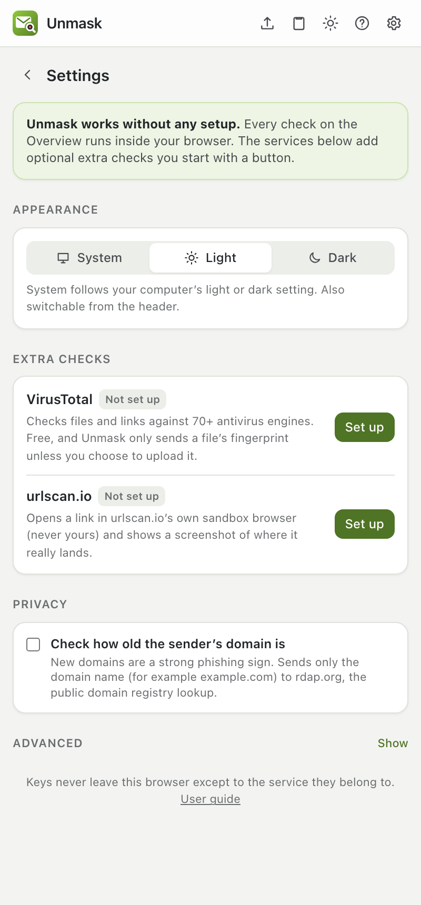

Open Settings with the **gear icon**. The **?** icon next to it opens this guide.

- **Extra checks:** each service shows **Connected** or **Not set up**, with buttons to set up, change or remove its key.
- **urlscan.io scans** are always private (50 free per day). There is no setting: links in your email can contain personal tokens.
- **Protection inside Gmail:** the warning banner, inbox badges, and the link and reply checks, each with its own switch.
- **Privacy → Remember who emails me:** powers first-contact warnings. Shows how many senders are remembered, with **Forget all**.
- **Privacy → Check how old the sender's domain is:** on by default. It sends only the domain name (for example `example.com`) to rdap.org, the public registry lookup.
- **Privacy → Check certificate history and mail records:** on by default. Sends only domain names to crt.sh and dns.google to spot brand-new certificates and domains without mail records, and fetches each DKIM signing key so Unmask can verify signatures itself.
- **Privacy → Check who runs the sending server:** off by default. Sends the IP address of the server that delivered the email (never your own) to dns.google, to spot mail sent from home connections and rented servers.
- **Appearance:** System (follows your computer), Light or Dark. The sun/moon button in the header switches it too.
- **Advanced → Redirect tracing:** *Inside Unmask* (default) or *My own server*, with the server's address.

<br clear="right">

---

## 10. Troubleshooting

**The panel says "Open Gmail to get started" even though Gmail is open.**
Click inside the Gmail tab so it's the active tab. The panel follows the tab you're looking at.

**The panel says "Reload Gmail to connect Unmask".**
Gmail was open before Unmask was installed or updated. Click **Reload Gmail** in the panel, or reload the tab.

**"Could not analyze this email".**
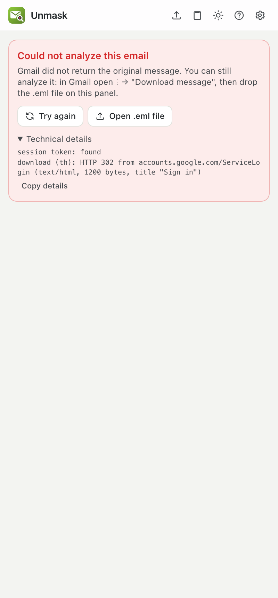
Click **Try again**. If it still fails, you can always analyze the email as a file: in Gmail, ⋮ → **Download message**, then drop the file on the panel. To report the problem, open **Technical details**, click **Copy details**, and include them in a [GitHub issue](https://github.com/praneeth132006/Unmask/issues). The details contain only status codes, never your email.

<br clear="right">

**The outline doesn't appear when I hover.**
Make sure the email is open in Gmail (not a downloaded file), and that the message is expanded rather than collapsed in the conversation. Some parts, such as headers and hidden text, have nothing visible to outline: click those findings instead.

**"VirusTotal says this key is not valid."**
Copy the key again from your [API key page](https://www.virustotal.com/gui/my-apikey) using the copy icon. Don't paste the page address.

**"VirusTotal rate limit reached."**
Free keys allow 4 lookups per minute. Wait a minute and try again.

**I updated the code but nothing changed.**
Run `pnpm build`, click **↻** on the Unmask card in `chrome://extensions`, then reload Gmail.

---

## 11. FAQ

**Does Unmask read all my email?**
No. It reads only the email you have open, and only while the panel is open. Nothing is stored or sent anywhere unless you click an online check.

**Does it need my Google password or Gmail access permissions?**
No. It uses Gmail's own "Show original" feature in your already signed-in tab. There's no OAuth and no Google API access.

**Why "No red flags found" instead of "Safe"?**
Because no tool can prove an email is safe. New attacks can pass every check. Unmask tells you what it found and what it didn't.

**A legitimate email got a warning. Is that a bug?**
Not necessarily. Some legitimate senders do things phishers also do, such as using link shorteners or sending from a new domain. Read the explanation and judge for yourself. If a check is clearly wrong, [open an issue](https://github.com/praneeth132006/Unmask/issues).

**Why do newsletters show trackers?**
Most marketing emails include tracking pixels so senders know who opened them. That's a privacy matter, not phishing, so trackers don't raise the risk score.

**Is it free? Can it ever cost me money?**
Unmask is free and open source (MIT). VirusTotal and urlscan.io have free plans, and **free keys can't be billed**: if you exceed a limit, the service just refuses requests until it resets. Paid plans exist only for heavy or commercial use. Full details: [Free limits and costs](LIMITS_AND_COSTS.md).
